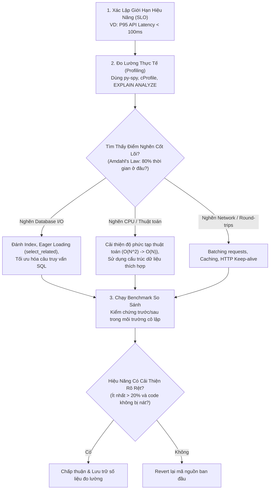

# Kỹ Thuật Đo Lường & Tối Ưu Hiệu Năng
# Performance Engineering & Rigorous Profiling

---

## 1. Nguyên Lý Nền Tảng (Fundamentals)

### 1.1. Định Luật Vàng: Không Tối Ưu Hóa Khi Chưa Đo Lường (No Optimization Without Measurement)
Theo lời cảnh báo kinh điển của Donald Knuth:
> *"Premature optimization is the root of all evil (or at least most of it) in programming."*
> (Tối ưu hóa sớm là nguồn gốc của mọi điều tồi tệ trong lập trình.)

Trực giác của con người và AI về hiệu năng thường sai lầm: Kỹ sư thường dành nhiều ngày viết lại một vòng lặp phức tạp để tiết kiệm 2 micro giây CPU, trong khi một câu lệnh SQL chưa được đánh index đang làm hệ thống nghẽn mất 300 mili giây ở mỗi request.

**Quy tắc vận hành tối thượng:**
- Tuyệt đối không thay đổi mã nguồn với lý do "tối ưu hiệu năng" nếu không có số liệu đo lường cụ thể (Profiling report hoặc Benchmark) chứng minh đoạn mã đó thực sự là điểm nghẽn.
- Mọi tối ưu hóa phải có số liệu so sánh rõ ràng: **Trước khi sửa (Baseline)** vs **Sau khi sửa (Optimized)**.

### 1.2. Phân Tách Giữa Chẩn Đoán Lỗi (Debugging) và Tối Ưu Hiệu Năng (Optimization)
- **Debugging:** Khôi phục **tính đúng đắn logic** khi hệ thống trả về kết quả sai hoặc sập.
- **Performance Optimization:** Cải thiện **tính hiệu quả về thời gian và tài nguyên** khi hệ thống đã chạy đúng logic.
- Không bao giờ tối ưu hóa một hàm chưa chạy đúng hoặc chưa có bộ test kiểm chứng độ tin cậy.

### 1.3. Hiểu Đúng Về Độ Trễ: Phân Vị Phân Phối Thay Vì Giá Trị Trung Bình
Không bao giờ dùng giá trị trung bình (Average / Mean) để đánh giá độ trễ hệ thống, vì giá trị trung bình che giấu hoàn toàn các điểm nghẽn nghiêm trọng:
- **P50 (Trung vị - Median):** 50% người dùng trải nghiệm tốc độ nhanh hơn mức này.
- **P95:** 95% người dùng trải nghiệm dưới mức này; 5% người dùng đang gặp trải nghiệm chậm.
- **P99 (Độ trễ đuôi - Tail Latency):** 1% người dùng (thường là những khách hàng tích cực nhất, có nhiều dữ liệu nhất) phải chịu đựng độ trễ này. Tối ưu hiệu năng xuất sắc là việc kéo phẳng đuôi P99.

---

## 2. Quy Trình Đo Lường & Khắc Phục Điểm Nghẽn (The Profiling Loop)



### 2.1. Profiling CPU & Bộ Nhớ (CPU & Memory Profiling)
- **Đồ thị ngọn lửa (Flamegraph):** Công cụ trực quan hóa mạnh mẽ nhất để nhận diện hàm nào đang tiêu tốn nhiều thời gian CPU nhất. Độ rộng của mỗi thanh đại diện cho tỷ lệ phần trăm thời gian CPU mà hàm đó chiếm dụng.
- **Sampling Profiler vs Deterministic Profiler:**
  - *Sampling Profiler (như `py-spy`):* Lấy mẫu call stack ngẫu nhiên từ bên ngoài tiến trình mà không làm chậm ứng dụng, cực kỳ an toàn để chạy trên môi trường staging hoặc production.
  - *Deterministic Profiler (như `cProfile`):* Đo lường mọi lời gọi hàm nhưng làm tăng overhead đáng kể, phù hợp cho môi trường phát triển cục bộ.
- **Truy vết rò rỉ bộ nhớ (Memory Leaks):** Sử dụng `tracemalloc` trong Python để so sánh các ảnh chụp bộ nhớ (Snapshots) giữa hai thời điểm, tìm ra đối tượng nào đang tăng sinh mất kiểm soát và không được bộ thu gom rác (Garbage Collector) dọn dẹp.

---

## 3. Tối Ưu Hóa Tầng Cơ Sở Dữ Liệu & I/O (Database & I/O Engineering)

Trong 90% các ứng dụng web thông thường, điểm nghẽn hiệu năng không nằm ở CPU của máy chủ ứng dụng mà nằm ở **các chuyến đi khứ hồi tới cơ sở dữ liệu (Database Round-trips)**.

### 3.1. Đại Dịch Truy Vấn N+1 (The N+1 Query Problem)
Vấn đề xảy ra khi mã nguồn thực hiện 1 câu truy vấn để lấy danh sách $N$ bản ghi cha, sau đó chạy thêm $N$ câu truy vấn riêng lẻ trong vòng lặp để lấy dữ liệu con liên quan:
```python
# SAI LẦM N+1 TRUY VẤN: Chạy 1 + 50 = 51 câu SQL
places = Place.objects.all()[:50]
for place in places:
    print(place.owner.username)  # Mỗi vòng lặp bắn 1 câu SELECT tới bảng User!
```

#### Giải pháp triệt để: Eager Loading
- Sử dụng `select_related()` cho các quan hệ một-một (OneToOne) hoặc nhiều-một (ForeignKey): Thực hiện phép `SQL JOIN` duy nhất ngay từ đầu.
- Sử dụng `prefetch_related()` cho các quan hệ một-nhiều (OneToMany) hoặc nhiều-nhiều (ManyToMany): Chạy đúng 2 câu truy vấn và tự động ghép nối dữ liệu trên bộ nhớ ứng dụng.
```python
# TỐI ƯU HÓA: Chạy đúng 1 câu SQL duy nhất có JOIN
places = Place.objects.select_related('owner').prefetch_related('photos')[:50]
```

### 3.2. Đánh Chỉ Mục Chuẩn Xác (Database Indexing)
Một bảng có 1,000,000 dòng nếu không có chỉ mục sẽ bắt buộc cơ sở dữ liệu phải quét tuần tự toàn bộ bảng (Sequential Scan), tốn hàng ngàn mili giây I/O đĩa:
- **B-Tree Index:** Chuẩn mực cho các phép so sánh bằng (`=`) và so sánh khoảng (`<`, `>`, `BETWEEN`).
- **GIST Index (Spatial):** Bắt buộc cho các truy vấn không gian địa lý PostGIS (tìm địa điểm trong bán kính $R$ mét hoặc nằm trong bounding box).
- **Composite Index (Chỉ mục kết hợp):** Đánh chỉ mục trên nhiều cột theo quy tắc tiền tố dài nhất (Leftmost Prefix Rule).

---

## 4. Chiến Lược Caching Bền Vững (Caching Strategies & Pitfalls)

Caching là kỹ thuật lưu tạm kết quả tính toán tốn kém vào bộ nhớ tốc độ cao (như Redis hoặc Memcached) để phục vụ cho các lần gọi tiếp theo.

### 4.1. Mẫu Thiết Kế Cache-Aside (Lazy Loading)
1. Ứng dụng nhận yêu cầu đọc dữ liệu.
2. Kiểm tra cache: Nếu có (Cache Hit), trả về kết quả ngay lập tức.
3. Nếu không có (Cache Miss), truy vấn từ cơ sở dữ liệu gốc, ghi kết quả vào cache kèm thời gian hết hạn (TTL - Time to Live), và trả về cho client.

### 4.2. Các Hiểm Họa Khi Caching & Cách Phòng Chống
1. **Thảm họa Cache Stampede / Dogpiling:** Khi một khóa cache cực kỳ phổ biến (ví dụ: trang chủ) bị hết hạn đúng vào lúc có 10,000 request ập đến cùng lúc. Cả 10,000 request đều gặp Cache Miss và cùng lúc dội xuống cơ sở dữ liệu, đánh sập DB ngay lập tức.
   - *Cách phòng chống:* Sử dụng khóa phân tán (Distributed Lock / Mutex) để chỉ cho phép 1 request đi xuống DB làm mới cache, các request khác chờ hoặc nhận dữ liệu cũ (Stale-While-Revalidate).
2. **Dữ liệu mồ côi (Stale Data):** Dữ liệu trong database đã bị sửa đổi nhưng cache vẫn giữ giá trị cũ.
   - *Cách phòng chống:* Bắt buộc mọi khóa cache phải có thời hạn tự hủy (TTL) hợp lý. Luôn có cơ chế chủ động xóa cache (Cache Invalidation) trong `services.py` khi có thao tác mutation.

---

## 5. Thiết Kế Benchmark Chuẩn Thống Kê (Rigorous Benchmark Design)

Viết benchmark sai cách sẽ cho ra các số liệu rác:
1. **Chu kỳ làm nóng (Warmup Cycles):** Bỏ qua các lần chạy đầu tiên vì hệ thống cần thời gian tải mã nguồn vào RAM, mở kết nối DB connection pool và biên dịch JIT.
2. **Kích thước mẫu đủ lớn (Statistical Significance):** Không đo 1 lần rồi kết luận. Chạy ít nhất 100 đến 1,000 lần lặp để loại trừ nhiễu từ hệ điều hành và các tiến trình nền.
3. **Môi trường cô lập:** Chạy benchmark trên môi trường không bị ảnh hưởng bởi tải mạng bên ngoài; giữ cố định cấu hình phần cứng và phiên bản thư viện.

---

## 6. Sai Lầm Thường Gặp & Anti-Patterns (Common Mistakes)

1. **Tối ưu hóa sớm phá vỡ kiến trúc (Clean Code vs Performance Extremism):** Viết code ngoằn ngoèo, bỏ hết các tầng trừu tượng rõ ràng chỉ để tiết kiệm một vài phép gán biến vô nghĩa.
2. **Coi Caching là thuốc chữa bách bệnh:** Lấy Caching để che giấu một câu truy vấn SQL viết ẩu chạy mất 10 giây. Khi cache hết hạn, người dùng vẫn phải chịu đựng độ trễ khủng khiếp. Hãy tối ưu hóa câu truy vấn gốc trước khi nghĩ tới việc đặt cache.
3. **Tạo đối tượng lặp đi lặp lại trong vòng lặp lớn (Excessive Allocations):** Khởi tạo các biểu thức chính quy (Compiled Regex) hoặc mở kết nối HTTP mới bên trong vòng lặp duyệt 100,000 phần tử thay vì tái sử dụng chúng.
4. **Bỏ qua Connection Pooling:** Mở một kết nối TCP mới tới database ở mỗi request rồi đóng lại, tiêu tốn 30–50% thời gian chỉ để thực hiện cú bắt tay TLS/TCP.

---

## 7. Đánh Giá Đánh Đổi & Ví Dụ Thực Tế Tại Rendez

### Bảng Đánh Đổi: Tối Ưu Tốc Độ Thuật Toán vs Độ Phức Tạp Mã Nguồn

| Giải Pháp | Mã Nguồn Đơn Giản, Dễ Đọc | Thuật Toán Tối Ưu Cực Đại |
|---|---|---|
| **Độ phức tạp nhận thức** | Thấp, kỹ sư nào cũng đọc hiểu ngay | Rất cao, đòi hỏi kiến thức chuyên sâu |
| **Chi phí bảo trì** | Cực thấp, dễ mở rộng và sửa lỗi | Cao, dễ sinh bug tiềm ẩn khi sửa đổi |
| **Hiệu năng thực tế** | Đủ nhanh cho 95% kịch bản thực tế | Nhanh hơn 3–5 lần trong các kịch bản cực hạn |
| **Quy tắc lựa chọn** | **Mặc định lựa chọn**, chỉ chuyển sang tối ưu cực đại khi profiling chứng minh điểm nghẽn |

### Minh Họa Thực Tế Tại Rendez: Tối Ưu Hóa Truy Vấn Khám Phá Không Gian
Trong Rendez, endpoint khám phá địa điểm theo bounding box bản đồ (`/api/places/?in_bbox=...`):
- **Hiện trạng ban đầu:** Khi chưa có chỉ mục GIST, PostgreSQL phải chạy `Seq Scan on places`, lọc qua từng tọa độ và tính toán giao cắt hình học bằng CPU. Thời gian phản hồi lên tới **450ms** với 10,000 địa điểm.
- **Phân tích đo lường (`EXPLAIN ANALYZE`):** Báo cáo chỉ rõ 92% thời gian dành cho quét đĩa tuần tự.
- **Giải pháp tối ưu dựa trên dữ liệu:**
  1. Thêm chỉ mục không gian trong migration:
     ```python
     migrations.AddIndex(
         model_name='place',
         index=django.contrib.postgres.indexes.GistIndex(fields=['location']),
     )
     ```
  2. Bổ sung `select_related('owner')` và `prefetch_related('photos')` trong `places/selectors.py`.
- **Kết quả đo lường sau khi sửa:**
  - PostgreSQL chuyển sang dùng `Index Scan using places_location_gist`.
  - Độ trễ P95 giảm từ **450ms xuống còn 18ms** (nhanh hơn 25 lần).
  - Không cần thêm tầng Redis cache phức tạp nào mà hệ thống vẫn đạt hiệu năng vượt kỳ vọng.
