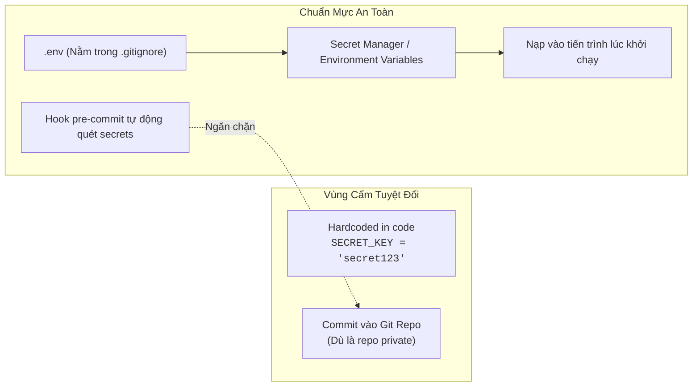

# Kỹ Thuật An Ninh Phần Mềm & Mô Hình Hóa Mối Đe Dọa
# Software Security Engineering & Threat Modeling

---

## 1. Nguyên Lý Nền Tảng (Fundamentals)

### 1.1. Ba Tiên Đề Vận Hành An Ninh Bắt Buộc
An ninh phần mềm không thể đạt được bằng cách "thêm vào sau" khi sản phẩm đã hoàn thiện. Nó phải là một thuộc tính được nhúng sâu vào từng quyết định thiết kế:

1. **Phòng thủ theo chiều sâu (Defense-in-Depth):** Không bao giờ phụ thuộc vào một rào chắn an ninh duy nhất. Nếu tường lửa mạng bị xuyên thủng, tầng xác thực API phải chặn lại; nếu tầng API bị lọt, quyền truy cập cấp đối tượng (Object-level Permission) phải ngăn chặn; nếu code bị lỗi, ràng buộc cơ sở dữ liệu và mã hóa đĩa cứng phải bảo vệ dữ liệu nhạy cảm.
2. **Đặc quyền tối thiểu (Principle of Least Privilege):** Mọi tiến trình, người dùng, dịch vụ nền hoặc cơ sở dữ liệu chỉ được cấp đúng những quyền hạn tối thiểu tuyệt đối cần thiết để hoàn thành công việc của nó, không bao giờ được cấp dư thừa quyền (ví dụ: web app không bao giờ được kết nối DB bằng tài khoản `postgres` superuser).
3. **Thất bại an toàn (Fail-Secure / Fail-Closed):** Khi một hàm kiểm tra quyền hoặc xác thực gặp lỗi bất ngờ (như mất mạng, ngoại lệ null, timeout), trạng thái mặc định bắt buộc phải là **Từ chối truy cập (Deny)**, tuyệt đối không được mở cửa cho qua (Fail-Open).

### 1.2. Phân Định Giữa Xác Thực (AuthN) và Phân Quyền (AuthZ)
Hai khái niệm này thường xuyên bị nhầm lẫn, dẫn đến các lỗ hổng chết người:
- **Xác thực (Authentication - AuthN):** *"Bạn là ai?"* — Quá trình kiểm chứng danh tính của thực thể thông qua mật khẩu, chữ ký số, token JWT, hoặc session cookie.
- **Phân quyền (Authorization - AuthZ):** *"Bạn được phép làm gì trên tài nguyên cụ thể này?"* — Quá trình kiểm tra xem người dùng đã được xác thực có quyền thực hiện hành động (Đọc, Sửa, Xóa) trên một thực thể dữ liệu cụ thể hay không.

---

## 2. Phòng Chống Lỗ Hổng Kiểm Soát Truy Cập Đối Tượng (IDOR Prevention)

Lỗ hổng **Insecure Direct Object References (IDOR)** (hay Broken Object-Level Authorization - BOLA) là lỗ hổng an ninh phổ biến và nguy hiểm số 1 trong các API hiện đại.

```mermaid
graph TD
    ClientReq["HTTP DELETE /api/photos/142/<br/>(Gửi kèm Token của User B)"] --> AuthN{"1. Xác Thực Danh Tính (AuthN)<br/>Token Có Hợp Lệ?"}

    AuthN -->|Không| Deny401["Trả về HTTP 401 Unauthorized"]
    AuthN -->|Có| AuthZ{"2. Phân Quyền Cấp Đối Tượng (AuthZ)<br/>User B có phải Owner của Photo 142<br/>hoặc Staff Admin?"}

    AuthZ -->|Không (IDOR Attack)| Deny403["Trả về HTTP 403 Forbidden<br/>(Ghi log cảnh báo an ninh)"]
    AuthZ -->|Có| Execute["3. Thực Thi Xóa Bản Ghi An Toàn"]
```

#### Quy tắc phòng ngừa IDOR tuyệt đối:
Không bao giờ tin tưởng ID do client gửi lên mà không kiểm tra quyền sở hữu trong truy vấn cơ sở dữ liệu:
```python
# SAI LẦM NGUY HIỂM: Bất kỳ ai đăng nhập cũng xóa được ảnh của người khác!
def delete_photo(request, photo_id):
    photo = Photo.objects.get(id=photo_id)
    photo.delete()

# CHUẨN XÁC: Kiểm tra quyền sở hữu trực tiếp trong truy vấn hoặc qua Permission Class
def delete_photo(request, photo_id):
    photo = get_object_or_404(Photo, id=photo_id)
    if photo.owner != request.user and not request.user.is_staff:
        raise PermissionDenied("Bạn không có quyền xóa ảnh này.")
    photo.delete()
```

---

## 3. Ranh Giới Vào/Ra Dữ Liệu & Zero-Trust (Input/Output Boundaries)

Nguyên tắc vàng của kiến trúc Zero-Trust: **Mọi dữ liệu đến từ bên ngoài ranh giới tin cậy (Trust Boundary) đều phải được coi là độc hại cho đến khi được chứng minh là an toàn.**

### 3.1. Thẩm Định Ở Đầu Vào (Sanitize & Validate at Ingress)
- **Chống SQL Injection:** Tuyệt đối không bao giờ nối chuỗi để tạo câu lệnh SQL (`f"SELECT * FROM users WHERE name = '{name}'"`). Luôn sử dụng ORM có tham số hóa (Parameterized Queries) chuẩn mực.
- **Chống Path Traversal:** Khi lưu file người dùng tải lên, không bao giờ dùng nguyên tên file gốc (`filename = request.FILES['file'].name`). Kẻ tấn công có thể gửi tên file như `../../etc/passwd` để ghi đè file hệ thống. Luôn sinh tên file ngẫu nhiên an toàn (UUIDv4/v7 hoặc mã băm SHA-256).
- **Chống Bom Giải Nén (Decompression Bomb / Zip Bomb):** Khi xử lý file nén hoặc file ảnh khổng lồ, luôn kiểm tra giới hạn kích thước tệp và giới hạn số pixel tối đa (Decompression Limit) trước khi giải nén vào bộ nhớ.

### 3.2. Mã Hóa Ở Đầu Ra (Context-Aware Output Encoding at Egress)
- **Chống Cross-Site Scripting (XSS):** Dữ liệu do người dùng nhập khi hiển thị lại trên trình duyệt phải được mã hóa phù hợp với ngữ cảnh (HTML Body, HTML Attribute, JavaScript String). Mặc định các framework hiện đại như React hay Django Template đều tự động encode, tuyệt đối không dùng `dangerouslySetInnerHTML` hoặc bộ lọc `|safe` nếu không được thẩm định kỹ lưỡng.

---

## 4. Quản Lý Bí Mật Tuyệt Đối An Toàn (Secrets Management & Hygiene)

Bí mật kỹ thuật (API keys, database passwords, secret keys mã hóa session, JWT secret) là chìa khóa vạn năng của hệ thống.



1. **Không bao giờ lưu bí mật trong Git:** Dù là repository riêng tư nội bộ, một khi bí mật đã bị commit vào lịch sử Git, nó phải được coi là đã bị lộ và phải được thu hồi/đổi mới (Rotate) ngay lập tức.
2. **Phân tách giữa `.env.example` và `.env`:** Tệp `.env.example` chỉ chứa tên các biến môi trường và giá trị mẫu an toàn, được commit lên Git làm tài liệu hướng dẫn. Tệp `.env` thật chứa bí mật thực tế bắt buộc phải nằm trong `.gitignore`.
3. **Quét tự động trước khi commit:** Tích hợp các công cụ quét bí mật (như `detect-secrets` hoặc `git-secrets`) vào hook `pre-commit` để chặn đứng việc commit nhầm khóa bí mật ngay tại máy của kỹ sư.

---

## 5. Rủi Ro Chuỗi Cung Ứng Mã Nguồn (Supply Chain Security)

Một hệ thống có thể được viết rất cẩn thận, nhưng một thư viện bên thứ ba bị cài mã độc có thể thỏa hiệp toàn bộ máy chủ.
- **Tấn công chiếm tên tương tự (Typosquatting):** Kẻ tấn công phát hành package với tên gần giống thư viện nổi tiếng (như `reqeusts` thay vì `requests`). Kỹ sư gõ nhầm lệnh cài đặt sẽ vô tình nạp mã độc vào hệ thống.
- **Khóa phiên bản và kiểm tra mã băm (Hash-checking mode):** Sử dụng lockfile có mã băm toàn vẹn (SHA-256 hashes) để đảm bảo package tải về từ máy chủ package không bị can thiệp trên đường truyền.
- **Quét lỗ hổng tự động (Vulnerability Scanning):** Tự động quét cơ sở dữ liệu lỗ hổng bảo mật đã biết (CVE) trong CI/CD bằng các công cụ như `pip-audit`, `npm audit`, hoặc `Dependabot`.

---

## 6. Mô Hình Hóa Mối Đe Dọa Bằng Khung STRIDE (Threat Modeling)

Trước khi viết code cho một tính năng lớn, kỹ sư trưởng thực hiện phân tích STRIDE để nhận diện trước các bề mặt tấn công:

| Ký Tự | Tên Mối Đe Dọa (Threat) | Định Nghĩa | Biện Pháp Phòng Vệ Chuẩn |
|:---:|---|---|---|
| **S** | **Spoofing (Giả mạo danh tính)** | Kẻ tấn công giả làm người dùng hợp lệ hoặc service khác | Xác thực mạnh, JWT có chữ ký số, HTTPS, mTLS |
| **T** | **Tampering (Can thiệp dữ liệu)** | Thay đổi trái phép dữ liệu trên đường truyền hoặc trong DB | Chữ ký số, HMAC, HTTPS, cơ sở dữ liệu toàn vẹn |
| **R** | **Repudiation (Chối bỏ trách nhiệm)** | Người dùng phủ nhận đã thực hiện một giao dịch nguy hại | Audit logs bất biến (Append-only logs) có timestamp |
| **I** | **Information Disclosure (Lộ thông tin)** | Rò rỉ dữ liệu nhạy cảm ra bên ngoài | Mã hóa dữ liệu tĩnh và động, xóa bỏ EXIF metadata |
| **D** | **Denial of Service (Từ chối dịch vụ)** | Làm cạn kiệt tài nguyên khiến người khác không dùng được | Rate limiting, timeouts, giới hạn kích thước payload |
| **E** | **Elevation of Privilege (Leo thang đặc quyền)**| Người dùng thường thực hiện được thao tác của quản trị viên | Phân quyền RBAC nghiêm ngặt tại Service boundary |

---

## 7. Sai Lầm Thường Gặp & Anti-Patterns (Common Mistakes)

1. **An ninh bằng sự mơ hồ (Security through Obscurity):** Tin rằng nếu giấu kín URL quản trị (`/bi-mat-admin-123/`) hoặc đổi cổng mặc định thì hệ thống sẽ an toàn mà không cần thiết lập xác thực mạnh.
2. **Để lộ Stack Trace ra màn hình lỗi client (Information Leakage):** Trả về toàn bộ chi tiết traceback, tên bảng SQL và đường dẫn file máy chủ trong HTTP 500 cho người dùng ngoài internet đọc.
3. **Bỏ qua xác thực quyền ở API con:** Chỉ kiểm tra quyền ở giao diện frontend (ẩn nút xóa) nhưng endpoint backend `/api/delete/` thì mở toang không kiểm tra quyền.
4. **Không thu hồi phiên làm việc khi đổi mật khẩu:** Người dùng đổi mật khẩu khi nghi ngờ bị hack tài khoản, nhưng các session cookie hoặc refresh token cũ vẫn tiếp tục có hiệu lực trên máy của kẻ tấn công.

---

## 8. Đánh Giá Đánh Đổi & Ví Dụ Thực Tế Tại Rendez

### Bảng Đánh Đổi: Trải Nghiệm Người Dùng (UX) vs An Ninh Nghiêm Ngặt

| Tính Năng | Thân Thiện UX Tuyệt Đối | An Ninh Phòng Thủ Cao | Quyết Định Cân Bằng Của Rendez |
|---|---|---|---|
| **Thông báo đăng nhập sai** | *"Email này không tồn tại trong hệ thống"* | *"Tài khoản hoặc mật khẩu không chính xác"* | **An ninh cao:** Ngăn chặn việc dò quét danh sách email người dùng (User Enumeration). |
| **Thời hạn phiên đăng nhập** | Duy trì vĩnh viễn không bao giờ logout | Hết hạn sau 15 phút không hoạt động | **Cân bằng:** Access token 15 phút, Refresh token 14 ngày có cơ chế xoay vòng (Rotation). |
| **Tải ảnh lên hệ thống** | Giữ nguyên mọi metadata gốc để tiện hiển thị ngày chụp | Xóa sạch toàn bộ metadata và chuyển đổi sang WebP | **An ninh cao:** Xóa sạch EXIF GPS để bảo vệ quyền riêng tư vị trí nhà riêng của người dùng. |

### Minh Họa Thực Tế Tại Rendez: `backend/apps/photos/images.py`
Trong pipeline chuẩn hóa ảnh đóng góp:
- Khi người dùng chụp ảnh quán cafe bằng điện thoại thông minh, ảnh gốc luôn chứa tọa độ GPS chính xác và thông tin thiết bị trong thẻ EXIF.
- Hàm `strip_exif_metadata()` đọc nhị phân ảnh, bóc tách toàn bộ thẻ metadata và chỉ lưu lại các pixel hình ảnh thuần túy:
  ```python
  def strip_exif_and_normalize(image_file: BinaryIO) -> BytesIO:
      with Image.open(image_file) as img:
          # Tạo ảnh mới chỉ chứa pixel data, triệt tiêu hoàn toàn EXIF tags
          data = list(img.getdata())
          clean_image = Image.new(img.mode, img.size)
          clean_image.putdata(data)

          output = BytesIO()
          clean_image.save(output, format="WEBP", quality=85)
          output.seek(0)
          return output
  ```
Kỹ thuật này bảo vệ an toàn quyền riêng tư cho người dùng theo đúng ranh giới pháp lý và quy chuẩn an ninh thông tin.
