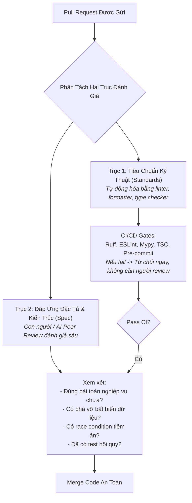
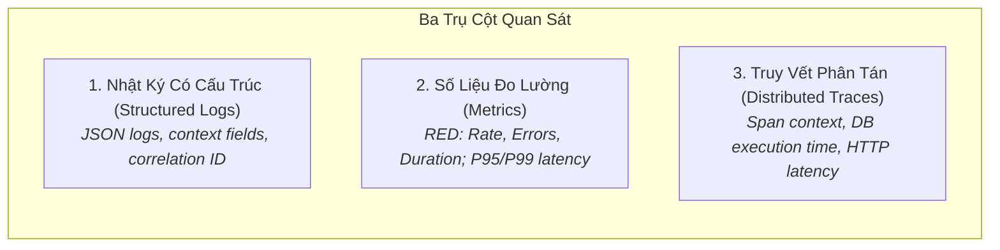

# Quản Trị Chất Lượng Phần Mềm & Năng Lực Quan Sát
# Software Quality Governance & Observability

---

## 1. Nguyên Lý Nền Tảng (Fundamentals)

### 1.1. Bản Chất Của Quản Trị Chất Lượng (Quality Governance)
Chất lượng phần mềm không phải là kết quả của sự may mắn hay nỗ lực cá nhân bột phát. Nó là **kết quả của một hệ thống quản trị có kỷ luật**, nơi các quy chuẩn kỹ thuật được tự động hóa tối đa và con người tập trung vào việc đánh giá logic nghiệp vụ, rủi ro kiến trúc và tính bền vững lâu dài.

### 1.2. Thẩm Định Mã Nguồn Hai Trục (Two-Axis Code Review)
Để buổi review mã nguồn (Code Review) đạt hiệu quả cao nhất và không biến thành các cuộc tranh cãi vô bổ về phong cách định dạng (tabs vs spaces), quy trình review cần được chia tách rạch ròi thành hai trục độc lập:



- **Quy tắc kích thước PR:** Một Pull Request lý tưởng không nên vượt quá **400 dòng thay đổi (Lines of Code)**. Các nghiên cứu đã chứng minh rằng khi PR vượt quá 500 dòng, khả năng phát hiện lỗi của người review giảm xuống gần bằng 0 (hội chứng "LGTM" - Looks Good To Me).

---

## 2. Phân Tích Tĩnh & Kiểm Soát Kiểu Dữ Liệu Nghiêm Ngặt (Static Analysis & Type Systems)

Phân tích tĩnh là lớp phòng thủ rẻ nhất và nhanh nhất trong chu trình phát triển:
1. **Kiểm tra kiểu dữ liệu tĩnh nghiêm ngặt (Strict Type Checking):** Sử dụng `mypy --strict` cho Python và `tsc --noEmit` cho TypeScript. Ép buộc mọi hàm công khai phải có type annotations rõ ràng. Kiểu dữ liệu chính là tài liệu kỹ thuật sống động nhất của mã nguồn.
2. **Bộ định dạng tự động không thương lượng (Zero-Tolerance Formatting):** Áp dụng các công cụ như `ruff format` hoặc `prettier`. Không bao giờ thảo luận về thụt lề, dấu phẩy cuối hay dấu ngoặc trong code review — hãy để máy móc tự động format lại mã nguồn trước mỗi lần commit.
3. **Phân tích AST & Lỗ hổng bảo mật (AST Linters & Security Scanners):** Quét các mẫu code nguy hiểm (như dùng `eval()`, hardcoded passwords, hoặc SQL injection) bằng các linter bảo mật tự động trong hook `pre-commit`.

---

## 3. Khả Năng Bảo Trì & Độ Phức Tạp Nhận Thức (Maintainability & Cognitive Load)

Một đoạn mã chạy được nhưng khó hiểu là một khoản nợ kỹ thuật nguy hiểm. Kỹ sư cần đo lường và kiểm soát hai chỉ số cốt lõi:
- **Độ phức tạp chu trình (Cyclomatic Complexity):** Đo lường số lượng đường dẫn thực thi độc lập qua một hàm (các khối `if`, `while`, `for`, `case`). Một hàm có cyclomatic complexity $> 10$ là dấu hiệu bắt buộc phải phân rã thành các hàm nhỏ hơn.
- **Tải trọng nhận thức (Cognitive Load):** Mức độ nỗ lực mà não bộ con người phải bỏ ra để ghi nhớ trạng thái các biến khi đọc mã nguồn. Cần ưu tiên các câu lệnh trả về sớm (Early Returns / Guard Clauses) để giảm độ sâu lồng nhau (Nesting Level) của mã nguồn xuống dưới 3 cấp.

---

## 4. Ba Trụ Cột Của Năng Lực Quan Sát (The Three Pillars of Observability)

Khả năng quan sát (Observability) là năng lực suy luận trạng thái nội tại của hệ thống dựa trên các dữ liệu đầu ra bên ngoài của nó. Trong môi trường production, đây là công cụ duy nhất giúp phát hiện và chẩn đoán sự cố.



### 4.1. Nhật Ký Có Cấu Trúc (Structured Logging)
Tuyệt đối không ghi log bằng chuỗi văn bản tự do (`logger.info("User logged in successfully")`). Mọi log phải là một đối tượng JSON có schema chuẩn:
```json
{
  "timestamp": "2026-10-30T17:20:00Z",
  "level": "INFO",
  "event": "photo_submission_created",
  "request_id": "req-8f4b-4c2a-9e1b",
  "user_id": 142,
  "place_id": 89,
  "photo_count": 3,
  "duration_ms": 142.5
}
```
Nhật ký JSON cho phép hệ thống quản lý log (Elasticsearch, Loki) lập chỉ mục và truy vấn tức thì theo bất kỳ trường nào mà không cần viết regex phức tạp.

### 4.2. Số Liệu Đo Lường Hệ Thống: Phương Pháp RED (Rate, Errors, Duration)
Với mọi dịch vụ backend, cần giám sát 3 chỉ số then chốt:
1. **Rate (Tốc độ):** Số lượng request hệ thống đang phục vụ mỗi giây (QPS).
2. **Errors (Tỷ lệ lỗi):** Số lượng request bị thất bại (HTTP 5xx, timeouts).
3. **Duration (Thời lượng / Độ trễ):** Thời gian cần thiết để xử lý một request, được đo lường dưới dạng phân phối phân vị: P50 (trung vị), P95, P99 (đuôi độ trễ).

### 4.3. Truy Vết Phân Tán (Distributed Tracing)
Mỗi HTTP request khi đi vào hệ thống được gắn một mã định danh duy nhất (`X-Request-ID` hoặc OpenTelemetry Trace ID). Mã này được truyền qua mọi lời gọi nội bộ (Database queries, Celery background tasks, External API calls). Khi có sự cố, kỹ sư có thể xem một dòng thời gian trực quan (Waterfall chart) chỉ rõ bước nào trong chuỗi xử lý đang làm nghẽn hệ thống.

---

## 5. Tài Liệu Kỹ Thuật Sống (Living Documentation)

Tài liệu kỹ thuật chết là tài liệu nằm trong các file Word/Wiki rời rạc không ai đọc và nhanh chóng trở nên lỗi thời sau 3 tháng.
- **Tài liệu sống gắn liền với mã nguồn:** Mọi tài liệu phải nằm trong chính repository (dưới định dạng Markdown), được cập nhật trong cùng một Pull Request khi code thay đổi.
- **Tự động sinh tài liệu từ mã nguồn:** Hợp đồng API phải được tự động sinh bằng OpenAPI/Swagger trực tiếp từ Serializers/Schemas của framework (ví dụ: `drf-spectacular` hoặc `FastAPI`), loại bỏ hoàn toàn việc gõ tài liệu API bằng tay.
- **Bình luận mã nguồn: Giải thích "TẠI SAO", không giải thích "CÁI GÌ":**
  - *Sai:* `# Tăng biến i lên 1` (Điều này code đã nói rất rõ).
  - *Đúng:* `# Bắt buộc phải khóa bản ghi ở đây bằng select_for_update() để ngăn chặn Race Condition khi hai người dùng cùng upload ảnh đại diện đồng thời.`

---

## 6. Sai Lầm Thường Gặp & Anti-Patterns (Common Mistakes)

1. **Bàn luận về phong cách trong Code Review (Style Nitpicking):** Dành 80% thời gian tranh cãi về dấu chấm phẩy hoặc khoảng trắng thay vì kiểm tra logic nghiệp vụ và rủi ro rò rỉ dữ liệu.
2. **Ghi log quá ít hoặc ghi log mù quáng (Log Pollution):** Ghi log toàn bộ payload nhị phân của ảnh hoặc ghi log chứa mật khẩu/token của người dùng; hoặc ngược lại, không ghi bất kỳ log nào khi service bị lỗi.
3. **Bỏ qua cảnh báo của Linter (Warning Blindness):** Tắt các quy tắc kiểm tra của linter bằng `# noqa` hoặc `// eslint-disable` bừa bãi chỉ để vượt qua CI mà không giải quyết vấn đề gốc.
4. **Cổng CI quá chậm (Slow CI Hell):** Test suite chạy mất hơn 45 phút khiến kỹ sư chán nản, bỏ qua việc chạy test cục bộ trước khi push, làm chậm toàn bộ tốc độ phát triển của đội ngũ.

---

## 7. Đánh Giá Đánh Đổi & Ví Dụ Thực Tế Tại Rendez

### Bảng Đánh Đổi: Kiểm Tra Tĩnh Nghiêm Ngặt vs Tốc Độ Prototype

| Tiêu Chí | Áp Dụng Strict Typing & Full Linter | Bỏ Qua Type Checking Để Viết Nhanh |
|---|---|---|
| **Thời gian ra mắt bản thử nghiệm đầu tiên** | Chậm hơn một chút (phải định nghĩa type đầy đủ) | Rất nhanh trong 1–2 ngày đầu |
| **Khả năng tự tin tái cấu trúc (Refactoring)** | Cực kỳ an toàn, trình biên dịch báo lỗi ngay khi đổi tên hàm | Rất nguy hiểm, phải dựa hoàn toàn vào trí nhớ hoặc test suite |
| **Chi phí bảo trì khi hệ thống lớn lên** | Ổn định, kỹ sư mới dễ dàng nắm bắt ngữ cảnh | Tăng theo cấp số nhân, code trở nên mong manh |

### Minh Họa Thực Tế Tại Rendez: Tự Động Hóa Kiểm Soát Bằng Makefile & Pre-commit
Trong Rendez, chất lượng mã nguồn được khóa chặt tại cổng vào cục bộ trước khi bất kỳ commit nào được tạo:
- Lệnh `make lint` chạy song song:
  - `ruff check backend/` để kiểm tra các code smell và vi phạm bảo mật trong Python.
  - `mypy backend/` để kiểm tra tính toàn vẹn của kiểu dữ liệu.
  - `npm run lint` và `tsc --noEmit` trong `frontend/` để kiểm tra React/TypeScript.
- Bất kỳ vi phạm nào về kiểu dữ liệu (ví dụ: một hàm trả về `Optional[Place]` nhưng caller không kiểm tra `None`) đều bị chặn đứng ngay lập tức tại máy của kỹ sư, không để lọt vào nhánh chính.
