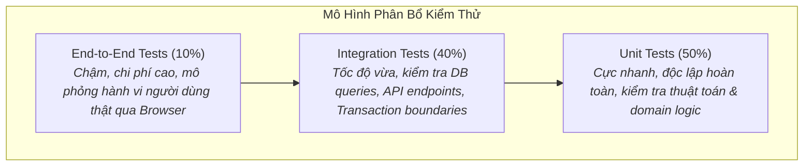

# Kiểm Thử Phần Mềm Toàn Diện & Thực Hành Test Đáng Tin Cậy
# Comprehensive Software Testing & Verification

---

## 1. Nguyên Lý Nền Tảng (Fundamentals)

### 1.1. Bản Chất Của Kiểm Thử Phần Mềm (Software Testing)
Kiểm thử phần mềm là hoạt động **kiểm chứng thực nghiệm (Empirical Verification)** nhằm trả lời câu hỏi: *"Mã nguồn này có thỏa mãn các kỳ vọng và bất biến đã định nghĩa trước hay không?"*.

Theo định lý nổi tiếng của Edsger W. Dijkstra:
> *"Program testing can be used to show the presence of bugs, but never to show their absence!"*
> (Kiểm thử chương trình chỉ có thể chứng minh sự hiện diện của lỗi, không bao giờ có thể chứng minh sự vắng mặt của lỗi!)

Do đó, mục tiêu của kiểm thử không phải là đạt được sự hoàn hảo lý thuyết, mà là **xây dựng một tấm lưới an toàn (Safety Net) có độ tin cậy cao** để kỹ sư và AI agents có thể tự tin tái cấu trúc và bổ sung tính năng mà không làm gãy hệ thống.

### 1.2. Phân Định Rạch Ròi: Testing vs Quality Assurance (QA)
- **Testing (Kiểm thử):** Là **hành động kỹ thuật vi mô**. Chạy một đoạn mã test để khẳng định một hàm trả về kết quả đúng với một bộ tham số đầu vào cụ thể.
- **Quality Assurance (Đảm bảo chất lượng):** Là **khung quản trị vĩ mô mang tính hệ thống**. QA bao gồm việc thiết kế quy trình review mã nguồn, phân tích tĩnh, quản lý rủi ro phát hành, giám sát độ trễ trên production, và văn hóa kỹ thuật nhằm đảm bảo toàn bộ tổ chức sản sinh ra phần mềm đạt chuẩn chất lượng cao. Kiểm thử là một công cụ cốt lõi của QA, nhưng kiểm thử không thể thay thế cho QA.

### 1.3. Cấu Trúc Chuẩn Của Một Ca Kiểm Thử: Mẫu AAA (Arrange - Act - Assert)
Mọi bài test sạch đều phải tuân thủ nghiêm ngặt 3 khối rõ ràng:
1. **Arrange (Chuẩn bị):** Khởi tạo môi trường, tạo dữ liệu giả lập (fixtures/factories), cấu hình các mock nếu cần.
2. **Act (Thực thi):** Gọi hàm hoặc endpoint cần kiểm tra với đúng một hành động duy nhất.
3. **Assert (Khẳng định):** Kiểm tra xem kết quả trả về và trạng thái hệ thống có khớp chính xác với kỳ vọng hay không.

---

## 2. Chiến Lược Kiểm Thử Đa Tầng (Multi-Layer Testing Strategy)

Một hệ thống kiểm thử lành mạnh áp dụng mô hình **Kim Tự Tháp Kiểm Thử (Testing Pyramid)** hoặc **Hình Thoi Kiểm Thử (Testing Diamond)** tùy theo đặc thù kiến trúc:



### 2.1. Kiểm Thử Đơn Vị (Unit Testing)
- **Đặc tính:** Chạy hoàn toàn trên bộ nhớ (In-memory), không chạm vào mạng, không gọi database thật, thời gian chạy dưới 5ms cho mỗi bài test.
- **Phạm vi:** Kiểm tra các hàm tính toán thuần túy (Pure functions), bộ lọc, chuyển đổi dữ liệu và logic nghiệp vụ độc lập.
- **Nguyên tắc:** Nếu một unit test cần kết nối internet hay đọc file trên đĩa, đó không phải là unit test.

### 2.2. Kiểm Thử Tích Hợp (Integration Testing)
- **Đặc tính:** Kiểm tra sự tương tác giữa hai hoặc nhiều thành phần của hệ thống (ví dụ: Django View + PostgreSQL Database + Serializer).
- **Phạm vi cốt tử:**
  - Kiểm tra tính đúng đắn của các câu lệnh truy vấn SQL phức tạp (spatial queries với PostGIS, aggregate, joins).
  - Kiểm tra các ràng buộc toàn vẹn cơ sở dữ liệu (`UniqueConstraint`, `ForeignKey` cascading delete).
  - Kiểm tra quản lý transaction: Đảm bảo dữ liệu bị rollback hoàn toàn khi một bước trong chuỗi nghiệp vụ bị lỗi.
- **Kỹ thuật Rollback sạch:** Trong Django/pytest-django, mỗi bài test chạy bên trong một database transaction và tự động rollback sau khi test kết thúc, giữ cho cơ sở dữ liệu luôn sạch sẽ giữa các ca test.

### 2.3. Kiểm Thử Đầu-Cuối (End-to-End / E2E Testing)
- **Đặc tính:** Khởi chạy toàn bộ hệ thống thật (Frontend React + Backend API + Database) và sử dụng trình duyệt không đầu (Headless Browser như Playwright) để mô phỏng tương tác của người dùng.
- **Chiến lược:** Chỉ tập trung vào các **Hành trình cốt tử của người dùng (Critical User Journeys)**: Đăng nhập $\rightarrow$ Tìm kiếm địa điểm trên bản đồ $\rightarrow$ Mở trang chi tiết $\rightarrow$ Gửi ảnh đóng góp.
- **Chống Flakiness (Kiểm thử chập chờn):** Không bao giờ dùng lệnh chờ cứng (`sleep(5)`). Luôn sử dụng cơ chế chờ tự động theo sự kiện DOM (`await page.waitForSelector(...)` hoặc `expect(locator).toBeVisible()`).

---

## 3. Ảo Tưởng Độ Bao Phủ & Kiểm Thử Đột Biến (Coverage Limits & Mutation Testing)

### 3.1. Cạm Bẫy 100% Độ Bao Phủ Dòng Mã (The 100% Line Coverage Illusion)
Độ bao phủ dòng mã (Line Coverage) chỉ cho biết dòng mã đó **đã được trình thông dịch chạy qua ít nhất một lần**, hoàn toàn không chứng minh dòng mã đó đã được kiểm tra đúng:

```python
def calculate_discount(price: float, is_vip: bool) -> float:
    if is_vip:
        price = price * 0.8
    return price

# Bài test đạt 100% line coverage nhưng hoàn toàn vô giá trị:
def test_calculate_discount_useless():
    calculate_discount(100.0, True)  # Không có câu lệnh assert nào!
```

### 3.2. Kiểm Thử Đột Biến (Mutation Testing): Thuốc Thử Thực Sự Của Test Suite
Kiểm thử đột biến tự động thay đổi mã nguồn hệ thống (đổi toán tử `>` thành `>=`, đổi `True` thành `False`, xóa một dòng code) và chạy lại test suite:
- Nếu test suite phát hiện ra và **bị thất bại (Fail)**: Đột biến bị tiêu diệt (Mutant Killed) $\rightarrow$ Test suite có chất lượng cao.
- Nếu test suite vẫn **vượt qua (Pass)**: Đột biến còn sống (Mutant Survived) $\rightarrow$ Test suite có lỗ hổng kiểm thử nghiêm trọng, đang bỏ sót các trường hợp biên.

---

## 4. Quản Lý Dữ Liệu Kiểm Thử: Factories Thay Vì Hardcoded Fixtures

Sai lầm lớn khi viết test là sử dụng các tệp JSON tĩnh chứa hàng trăm bản ghi cứng với các ID cố định (`id: 1`, `id: 2`):
- Khi schema thay đổi một trường, hàng chục tệp JSON bị gãy.
- Các bài test bị phụ thuộc lẫn nhau (Test Couplings): Test A sửa bản ghi `id: 1` khiến Test B chạy sau bị fail bất thường.

### Cách Tiếp Cận Chuẩn: Model Factories
Sử dụng các thư viện Factory (như `factory_boy` trong Python hoặc builder functions) để tạo dữ liệu động theo nhu cầu của từng bài test:
```python
# Chỉ chỉ định các trường quan trọng đối với ca test cụ thể đó
def test_place_is_open_at_noon():
    place = PlaceFactory.create(name="Cafe Da Nang")
    OpeningHoursFactory.create(place=place, day_of_week=0, opens="08:00", closes="18:00")

    assert place.is_open_at(noon_time) is True
```

---

## 5. Kiểm Thử Dựa Trên Thuộc Tính (Property-Based Testing)

Trong kiểm thử truyền thống (Example-based testing), kỹ sư chỉ kiểm tra các giá trị cụ thể mà họ tự nghĩ ra (ví dụ: `2 + 2 = 4`). Điều này thường bỏ sót các trường hợp biên kỳ quái mà con người không lường trước được (chuỗi Unicode rỗng, số âm, số nguyên cực lớn, ký tự null byte).

### Nguyên Lý Của Property-Based Testing (Hypothesis / Fast-Check)
Thay vì kiểm tra ví dụ, ta khẳng định các **Thuộc tính bất biến (Universal Invariants)** của hệ thống:
1. **Tính khả nghịch (Round-trip / Serialization Invariant):**
   Với mọi đối tượng `Place` hợp lệ: `deserialize(serialize(place)) == place`.
2. **Tính đơn điệu hoặc chặn trên/dưới:**
   Khoảng cách địa lý giữa hai điểm bất kỳ trên trái đất luôn thỏa mãn: `distance(A, B) >= 0` và `distance(A, B) == distance(B, A)`.
3. **Thư viện tự động sinh hàng ngàn dữ liệu ngẫu nhiên** để cố gắng phá vỡ bất biến. Khi tìm thấy một ca lỗi, thư viện sẽ tự động **thu nhỏ (Shrink)** payload về trường hợp tối thiểu nhất giúp kỹ sư sửa lỗi dễ dàng.

---

## 6. Sai Lầm Thường Gặp & Anti-Patterns (Common Mistakes)

1. **Kiểm thử phụ thuộc thứ tự (Flaky Order-Dependent Tests):** Test A phải chạy trước Test B thì Test B mới pass vì Test A tạo dữ liệu trong DB mà không dọn dẹp. Mọi bài test phải có khả năng chạy độc lập và chạy theo thứ tự ngẫu nhiên (`pytest --randomly`).
2. **Lạm dụng Mock quá đà (Mocking Hell):** Mock toàn bộ database, mock luôn cả ORM và các service nội bộ. Kết quả là bài test chạy cực nhanh nhưng không kiểm tra được gì, khi chạy thật trên production thì hệ thống sập do câu lệnh SQL sai cú pháp.
3. **Bỏ qua Assertions (Test không có khẳng định):** Viết test chỉ để kích hoạt code nhằm tăng số phần trăm coverage mà không kiểm tra tính đúng đắn của dữ liệu đầu ra.
4. **Kiểm thử chi tiết hiện thực thay vì hành vi (Testing Implementation Details):** Assert rằng một hàm nội bộ riêng tư (private method) được gọi đúng 2 lần. Khi tái cấu trúc mã nguồn bên trong mà không đổi API ngoài, test bị gãy vô cớ.

---

## 7. Đánh Giá Đánh Đổi & Ví Dụ Thực Tế Tại Rendez

### Bảng Đánh Đổi: Test Với Database Thật vs Test Dùng Mock

| Khía Cạnh | Dùng Database Thật (PostgreSQL Rollback) | Dùng Mock Hoàn Toàn (Mocking Database) |
|---|---|---|
| **Tốc độ thực thi** | Chậm hơn (10–50ms mỗi test) | Cực nhanh (dưới 1ms mỗi test) |
| **Độ tin cậy của truy vấn SQL** | Tuyệt đối — bắt được lỗi cú pháp, types, spatial joins | Bằng 0 — mock chỉ trả về những gì người viết test tưởng tượng |
| **Chi phí bảo trì test** | Thấp — test phản ánh đúng hành vi của hệ thống | Rất cao — sửa schema là phải sửa lại toàn bộ mock |
| **Khuyến nghị áp dụng** | **Bắt buộc** cho toàn bộ integration test và selector tests | Chỉ dùng cho các dịch vụ bên thứ ba (Stripe, Cloud Storage) |

### Minh Họa Thực Tế Tại Rendez: `backend/tests/test_upload_safety.py`
Trong hệ thống upload ảnh của Rendez, việc bảo vệ an toàn tệp tin tải lên được kiểm thử nghiêm ngặt thông qua bài test tích hợp:
- **Tình huống kiểm thử:** Một kẻ tấn công cố tình tải lên một file script độc hại nhưng đổi đuôi thành `.jpg`, hoặc một file ảnh bị hỏng cấu trúc nhị phân.
- **Bài test khẳng định:**
  1. Pipeline phát hiện chính xác Magic Bytes không phải ảnh thật.
  2. Hệ thống ném ngoại lệ `InvalidImageError` ngay tại boundary.
  3. Cơ sở dữ liệu không tạo bất kỳ bản ghi rác nào (Rollback sạch).
  4. File tạm thời trên ổ đĩa bị xóa bỏ hoàn toàn, không để lại rác thải bộ nhớ.
