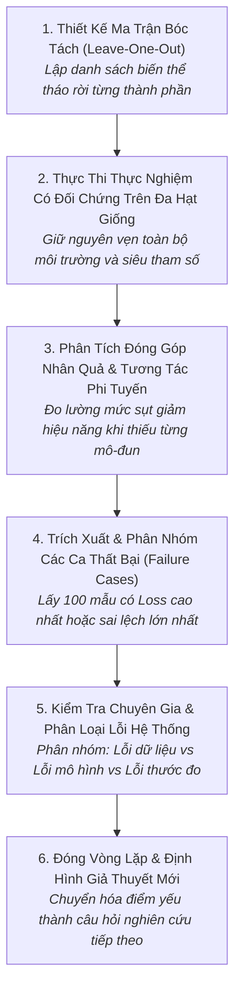

# Quy Trình Nghiên Cứu Bóc Tách & Phân Tích Lỗi Hệ Thống
# Ablation Studies & Systematic Failure Analysis Workflow

---

## 1. Mục Đích (Purpose)
Quy trình này hướng dẫn nhà nghiên cứu thực hiện hai hoạt động đào sâu mang tính bản chất khoa học: (1) **Nghiên cứu bóc tách (Ablation Study)** để quy kết chính xác đóng góp nhân quả của từng mô-đun kỹ thuật và triệt tiêu các thành phần thừa; và (2) **Phân tích lỗi hệ thống (Systematic Failure Analysis)** nhằm bóc trần điểm mù của mô hình và tạo động lực cho chu trình nghiên cứu tiếp theo.

---

## 2. Điều Kiện Tiên Quyết (Preconditions)
- Mô hình đề xuất đầy đủ đã hoàn tất đánh giá và đạt kết quả khả quan trên tập kiểm thử.
- Kiến trúc mã nguồn được thiết kế dạng mô-đun cắm-rút cho phép bật/tắt từng khối mà không làm hỏng chương trình.

---

## 3. Dữ Liệu Đầu Vào (Inputs)
- Mô hình hoàn chỉnh và tập kiểm thử.
- Danh sách các thành phần mới được đề xuất cần thẩm tra.

---

## 4. Kết Quả Đầu Ra Kỳ Vọng (Expected Outputs)
- **Bảng Nghiên Cứu Bóc Tách Chuẩn Mực (Ablation Table):** Đi kèm số liệu hiệu năng, dung lượng tham số và độ trễ của từng biến thể.
- **Bảng Thống Kê Phân Loại Lỗi (Qualitative Error Audit Table):** Phân tích chi tiết 50–100 ca dự đoán sai nặng nhất.
- **Danh mục giả thuyết mới:** Định hướng cho giai đoạn nghiên cứu kế tiếp.

---

## 5. Các Giai Đoạn Chính (Main Stages)

### Chi Tiết Từng Giai Đoạn:
- **GĐ 1: Thiết kế ma trận:** Lập kế hoạch tháo rời có chủ đích: Bỏ kiến trúc mới, bỏ hàm loss mới, bỏ nhúng thời gian (xem [`ablation-studies-and-attribution.md`](file:///home/longtran/Projects/rendez-web/erpf/ai-research/evaluation-validation/ablation-studies-and-attribution.md)).
- **GĐ 2: Chạy có đối chứng:** Chạy các biến thể trên cùng các hạt giống ngẫu nhiên như mô hình chính.
- **GĐ 3: Phân tích nhân quả:** Đánh giá xem thành phần nào thực sự làm tăng điểm. Nếu tháo bỏ thành phần $X$ mà điểm không giảm $\rightarrow$ **Xóa bỏ thành phần $X$ khỏi mô hình đề xuất**!
- **GĐ 4: Trích xuất ca lỗi:** Lọc các ca False Positives và False Negatives điển hình nhất.
- **GĐ 5: Kiểm tra thủ công:** Mở ảnh và văn bản ra đọc bằng mắt người; tìm kiếm các mẫu hình lỗi lặp lại (Systematic Error Patterns) (xem [`failure-analysis-and-error-categorization.md`](file:///home/longtran/Projects/rendez-web/erpf/ai-research/evaluation-validation/failure-analysis-and-error-categorization.md)).
- **GĐ 6: Đóng vòng lặp:** Viết mục "Limitations" trong bài báo và đề xuất hướng cải tiến cho tương lai.

---

## 6. Điểm Ra Quyết Định Rẽ Nhánh (Decision Points & Professional Judgment)

- **Điểm rẽ 1: Một thành phần trong mô hình khi tháo ra chỉ làm giảm 0.1% điểm số:**
  - **HÃY DŨNG CẢM XÓA BỎ THÀNH PHẦN ĐÓ!** Không giữ lại một khối kiến trúc phức tạp tốn kém tham số chỉ để đổi lấy 0.1% điểm số nằm trong khoảng nhiễu thống kê. Mô hình đơn giản hơn luôn là mô hình tốt hơn (Occam's Razor).
- **Điểm rẽ 2: Lỗi sai là do dữ liệu nhãn bị sai hay do mô hình học dở?**
  - Nếu kiểm tra 100 mẫu lỗi thấy có tới 30 mẫu nhãn ground-truth bị gán sai $\rightarrow$ **Dừng mô hình hóa và thực hiện quy trình dọn dẹp dữ liệu (Data Cleaning Iteration)**.

---

## 7. Phương Pháp & Kỹ Thuật Áp Dụng (Methods & Techniques)
- Quy trình tháo rời từng phần (Leave-One-Out Ablation Protocol).
- Phân tích hiệu ứng tương tác phi tuyến (Synergy Analysis).
- Phân tích lỗi định tính có gán nhãn chuyên gia (Qualitative Error Audit).

---

## 8. Các Dạng Thất Bại & Sai Lầm Thường Gặp (Common Failure Modes)
- **Bóc tách chiếu lệ:** Chỉ thử thay đổi vài siêu tham số nhỏ mà không tháo bỏ các khối kiến trúc chính.
- **Che giấu các trường hợp lỗi:** Chỉ trưng ra các ví dụ dự đoán đẹp và bỏ qua các ca mô hình nói nhảm hoặc nhận diện sai thảm hại.
- **Đổ lỗi cho ngẫu nhiên:** Coi tất cả các lỗi là do "nhiễu ngẫu nhiên" mà không chịu tìm hiểu xem có quy luật hệ thống nào ẩn phía sau hay không.

---

## 9. Cổng Kiểm Soát Chất Lượng (Quality Checkpoints)
- [ ] Bảng bóc tách bao gồm đầy đủ mọi thành phần mới được giới thiệu trong phần Phương pháp.
- [ ] Mỗi biến thể bóc tách đều có báo cáo số lượng tham số và thời gian suy luận.
- [ ] Đã kiểm tra thủ công bằng mắt ít nhất 50 ca dự đoán sai nặng nhất.
- [ ] Báo cáo chỉ rõ ít nhất 2 hạn chế hoặc điểm mù có hệ thống của mô hình.

---

## 10. Lộ Trình Thay Thế / Thoát Hiểm (Alternative Paths)
- Nếu số lượng thành phần quá nhiều ($K > 6$) khiến việc bóc tách toàn phần vượt ngân sách GPU: **Nhóm các thành phần có tính tương đồng thành 3 cụm logic lớn và thực hiện bóc tách ở cấp độ cụm (Cluster-level Ablation)**.

---

## 11. Nguyên Lý & Năng Lực Liên Quan
- **Nguyên lý cốt lõi:** Intellectual Honesty, Root Cause Analysis, Simplest Sufficient Solution (`ERPF-CORE-PRIN-001`).
- **Năng lực áp dụng:** C2 (Analytical Reasoning), C3 (Critical Evaluation), C10 (Self-Assessment).
