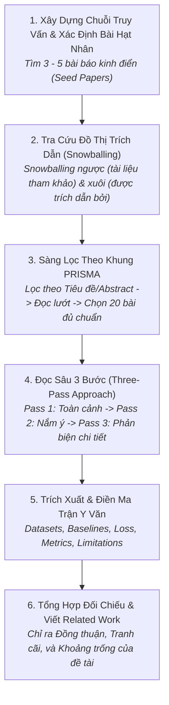

# Quy Trình Khảo Sát & Tổng Hợp Y Văn Học Thuật
# Systematic Literature Review & Synthesis Workflow

---

## 1. Mục Đích (Purpose)
Quy trình này hướng dẫn nhà nghiên cứu và AI Research Agent thực hiện một đợt khảo sát tài liệu học thuật **có hệ thống, toàn diện, không thiên vị, không bị ảo giác trích dẫn và tổng hợp được bức tranh toàn cảnh về SOTA** nhằm định vị chính xác khoảng trống tri thức (Research Gap) cho đề tài.

---

## 2. Điều Kiện Tiên Quyết (Preconditions)
- Đã xác định rõ từ khóa chủ đề và câu hỏi nghiên cứu sơ bộ.
- Có khả năng truy cập các cơ sở dữ liệu học thuật mở: Semantic Scholar, arXiv, DBLP, Google Scholar, ACL Anthology.

---

## 3. Dữ Liệu Đầu Vào (Inputs)
- Chuỗi truy vấn tìm kiếm (Search queries với toán tử Boolean: AND, OR, NOT).
- Tiêu chí bao hàm và loại trừ (Inclusion & Exclusion Criteria).

---

## 4. Kết Quả Đầu Ra Kỳ Vọng (Expected Outputs)
- **Ma Trận Tổng Hợp Y Văn Hoàn Chỉnh (Completed Literature Matrix):** Theo mẫu chuẩn [`literature-matrix-template.md`](file:///home/longtran/Projects/rendez-web/erpf/toolkit/templates/literature-matrix-template.md) chứa từ 15 đến 30 bài báo được phân tích sâu.
- **Bản thảo phần Related Work:** Được cấu trúc theo các trường phái giải pháp thay vì danh sách giặt ủi rời rạc.

---

## 5. Các Giai Đoạn Chính (Main Stages)

### Chi Tiết Từng Giai Đoạn:
- **GĐ 1: Truy vấn & Bài hạt nhân:** Xác định các từ khóa chính xác trong tiếng Anh chuyên ngành.
- **GĐ 2: Snowballing:** Lần theo đồ thị trích dẫn để không bị bỏ sót các công trình quan trọng không chứa đúng từ khóa tìm kiếm (xem [`literature-review-and-synthesis.md`](file:///home/longtran/Projects/rendez-web/erpf/ai-research/methodology/literature-review-and-synthesis.md)).
- **GĐ 3: Lọc PRISMA:** Loại bỏ các bài báo kém chất lượng, bài báo không có mã nguồn hoặc không công bố kết quả trên benchmark chuẩn.
- **GĐ 4: Đọc Three-Pass:** Áp dụng kỹ thuật của S. Keshav; chỉ dành thời gian đọc sâu Bước 3 cho top 5–7 bài báo quan trọng nhất.
- **GĐ 5: Điền ma trận:** Nhập thông tin vào bảng Markdown chuẩn 10 cột.
- **GĐ 6: Viết Related Work:** Nhóm các bài báo thành 2–3 trường phái tư tưởng chính.

---

## 6. Điểm Ra Quyết Định Rẽ Nhánh (Decision Points & Professional Judgment)

- **Điểm rẽ 1: Đánh giá bài báo trên arXiv chưa qua Peer-Review:**
  - *Nguyên tắc:* Trong lĩnh vực AI phát triển nhanh, bài báo arXiv mới nhất (trong 6 tháng) có thể được tham khảo, nhưng **bắt buộc phải kiểm tra mã nguồn đi kèm**. Nếu bài báo tuyên bố kết quả phi thường nhưng không có code và tác giả không có hồ sơ học thuật uy tín $\rightarrow$ **Loại khỏi danh sách hạt nhân**.
- **Điểm rẽ 2: Khi nào được phép dừng việc khảo sát y văn?**
  - Khi bạn thực hiện Snowballing trên các bài báo mới mà danh mục tài liệu tham khảo của chúng **liên tục lặp lại các bài báo mà bạn đã đọc rồi** (điểm bão hòa thông tin).

---

## 7. Phương Pháp & Kỹ Thuật Áp Dụng (Methods & Techniques)
- Kỹ thuật Đọc bài báo 3 bước (Three-Pass Approach của S. Keshav).
- Quy trình sàng lọc có hệ thống PRISMA.
- Ma trận tổng hợp y văn học thuật ([`literature-matrix-template.md`](file:///home/longtran/Projects/rendez-web/erpf/toolkit/templates/literature-matrix-template.md)).

---

## 8. Các Dạng Thất Bại & Sai Lầm Thường Gặp (Common Failure Modes)
- **Ảo giác trích dẫn (Citation Hallucination):** Tự bịa đặt tên bài báo hoặc trích dẫn nguồn không có thật.
- **Danh sách giặt ủi (Laundry List Review):** Tóm tắt từng bài báo rời rạc: "Tác giả A làm X. Tác giả B làm Y. Tác giả C làm Z." mà không có sự liên kết hay so sánh.
- **Thiên vị trích dẫn (Confirmation Bias):** Cố tình lờ đi các nghiên cứu chỉ ra nhược điểm của phương pháp mà mình dự định theo đuổi.

---

## 9. Cổng Kiểm Soát Chất Lượng (Quality Checkpoints)
- [ ] 100% trích dẫn đều có thể truy vết trên Semantic Scholar, arXiv hoặc Google Scholar.
- [ ] Ma trận y văn có đầy đủ ít nhất 15 bài báo liên quan mật thiết.
- [ ] Mỗi bài báo hạt nhân đều được bóc tách rõ ràng các giới hạn cốt tử (Limitations).
- [ ] Đã xác định rõ ít nhất một tranh cãi học thuật chưa ngã ngũ trong y văn.

---

## 10. Lộ Trình Thay Thế / Thoát Hiểm (Alternative Paths)
- Nếu đề tài quá mới và hầu như chưa có bài báo khoa học nào trực tiếp giải quyết: **Mở rộng tìm kiếm sang các lĩnh vực lân cận có tính tương đồng về mặt toán học hoặc cấu trúc dữ liệu** (Cross-Domain Transfer).

---

## 11. Nguyên Lý & Năng Lực Liên Quan
- **Nguyên lý cốt lõi:** Intellectual Honesty, Evidence-Based Reasoning (`ERPF-CORE-PRIN-001`).
- **Năng lực áp dụng:** C4 (Information Literacy & Synthesis), C3 (Critical Evaluation), C8 (Technical Communication).
