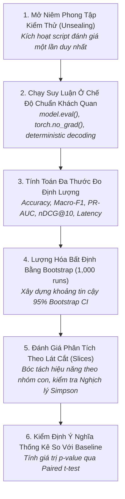

# Quy Trình Thẩm Định Mô Hình & Đánh Giá Benchmark
# Model Evaluation & Benchmark Assessment Workflow

---

## 1. Mục Đích (Purpose)
Quy trình này hướng dẫn việc thực hiện đánh giá chính thức mô hình học máy trên **tập kiểm thử niêm phong (Sealed Test Set)** một cách khách quan, công bằng và có ý nghĩa thống kê: Đo lường đa thước đo, lượng hóa độ bất định qua Bootstrap Resampling (95% CI), phân tích lát cắt nhóm con (Slice-based) và thực hiện kiểm định giả thuyết cặp đôi so với Baseline.

---

## 2. Điều Kiện Tiên Quyết (Preconditions)
- Quá trình phát triển và lựa chọn siêu tham số trên tập Validation đã kết thúc hoàn toàn.
- Checkpoint mô hình tốt nhất (`checkpoint_best.pt`) đã được khóa và lưu trữ.
- Tập dữ liệu kiểm thử (Test Set) chưa từng được mô hình tiếp xúc trong quá trình huấn luyện.

---

## 3. Dữ Liệu Đầu Vào (Inputs)
- Checkpoint mô hình đề xuất và Checkpoint của các mô hình Baselines.
- Tập dữ liệu kiểm thử chuẩn hóa và kịch bản đánh giá cố định.

---

## 4. Kết Quả Đầu Ra Kỳ Vọng (Expected Outputs)
- **Báo Cáo Đánh Giá Thẩm Định Chính Thức (Official Evaluation Report):**
  1. Bảng số liệu tổng hợp đi kèm khoảng tin cậy 95% Bootstrap CI.
  2. Bảng phân tích hiệu năng theo từng lát cắt dữ liệu nhạy cảm (Slices).
  3. Giá trị $p$ từ kiểm định thống kê cặp đôi (Paired t-test / Wilcoxon) so với Baselines.

---

## 5. Các Giai Đoạn Chính (Main Stages)

### Chi Tiết Từng Giai Đoạn:
- **GĐ 1: Mở niêm phong:** Chỉ nạp dữ liệu Test Set ở giai đoạn này (xem [`dataset-analysis-and-leakage.md`](file:///home/longtran/Projects/rendez-web/erpf/ai-research/empirical-loop/dataset-analysis-and-leakage.md)).
- **GĐ 2: Suy luận chuẩn:** Bắt buộc đặt `model.eval()`; tắt tính toán gradient để tiết kiệm bộ nhớ; với LLM đặt `temperature=0` để kết quả có tính tất định.
- **GĐ 3: Đa thước đo:** Không chỉ nhìn vào Accuracy; tính toán đầy đủ Precision, Recall, Macro-F1 và nDCG (xem [`model-evaluation-and-benchmarks.md`](file:///home/longtran/Projects/rendez-web/erpf/ai-research/evaluation-validation/model-evaluation-and-benchmarks.md)).
- **GĐ 4: Bootstrap Sampling:** Chạy 1,000 lần lấy mẫu lại có hoàn lại để xây dựng phân phối khoảng tin cậy 95%.
- **GĐ 5: Phân tích lát cắt:** Kiểm tra xem mô hình có bị sụp đổ ở nhóm thiểu số hoặc nhóm dữ liệu ban đêm không.
- **GĐ 6: Kiểm định thống kê:** Khẳng định xem sự chênh lệch có đạt ngưỡng ý nghĩa thống kê $p < 0.05$ hay không.

---

## 6. Điểm Ra Quyết Định Rẽ Nhánh (Decision Points & Professional Judgment)

- **Điểm rẽ 1: Khoảng tin cậy 95% của mô hình đề xuất và baseline bị chồng lấn (Overlapping):**
  - **TUYỆT ĐỐI KHÔNG TUYÊN BỐ VƯỢT TRỘI!** Bắt buộc phải ghi nhận trung thực: *"Phương pháp đề xuất đạt điểm trung bình cao hơn nhưng sự khác biệt chưa đạt ý nghĩa thống kê ở mức tin cậy 95% (p = 0.08)"*.
- **Điểm rẽ 2: Mô hình thắng ở điểm tổng hợp nhưng thua ở lát cắt cốt lõi:**
  - Nếu mô hình đạt Accuracy tổng thể 92% nhưng trên nhóm đối tượng yếu thế chỉ đạt 30% $\rightarrow$ **Cảnh báo rủi ro an toàn và đạo đức (Safety Blocker)**, không được phép đưa vào production.

---

## 7. Phương Pháp & Kỹ Thuật Áp Dụng (Methods & Techniques)
- Kỹ thuật lấy mẫu lại Bootstrap (Bootstrap Resampling Protocol).
- Đánh giá phân tích theo lát cắt (Slice-Based Evaluation).
- Kiểm định thống kê cặp đôi (Paired Student's t-test / Wilcoxon signed-rank test).

---

## 8. Các Dạng Thất Bại & Sai Lầm Thường Gặp (Common Failure Modes)
- **Báo cáo điểm số đơn lẻ:** Đưa ra con số 85.3% mà không có khoảng tin cậy hay độ lệch chuẩn.
- **Quên `model.eval()`:** Để mô hình ở chế độ huấn luyện khiến Dropout vẫn tiếp tục tắt ngẫu nhiên nơ-ron lúc test.
- **Ảo tưởng điểm trung bình:** Bị che giấu bởi Nghịch lý Simpson, không biết rằng mô hình đang hoạt động cực kỳ tệ hại trên các ca thực tế khó.

---

## 9. Cổng Kiểm Soát Chất Lượng (Quality Checkpoints)
- [ ] Script đánh giá chạy hoàn toàn tự động từ đầu đến cuối trên tập test niêm phong.
- [ ] Bảng kết quả có đầy đủ Mean, Std, và 95% Bootstrap Confidence Intervals.
- [ ] Giá trị p-value được tính toán rõ ràng so với từng baseline cạnh tranh.
- [ ] Báo cáo có biểu đồ phân tích ít nhất 3 lát cắt dữ liệu con quan trọng.

---

## 10. Lộ Trình Thay Thế / Thoát Hiểm (Alternative Paths)
- Nếu tập dữ liệu kiểm thử quá nhỏ (dưới 100 mẫu) khiến kiểm định thống kê thiếu sức mạnh: **Áp dụng kỹ thuật Đánh giá Chéo k-lần Lồng nhau (Nested k-Fold Cross-Validation)** để tận dụng tối đa dữ liệu mà vẫn bảo toàn tính khách quan.

---

## 11. Nguyên Lý & Năng Lực Liên Quan
- **Nguyên lý cốt lõi:** Intellectual Honesty, Evidence-Based Reasoning, Critical Thinking (`ERPF-CORE-PRIN-001`).
- **Năng lực áp dụng:** C3 (Critical Evaluation), C2 (Analytical Reasoning), C8 (Technical Communication).
