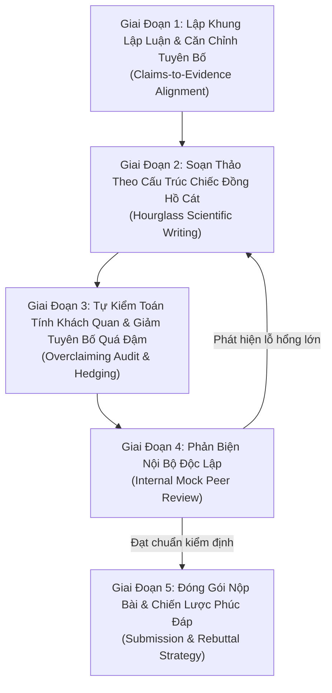
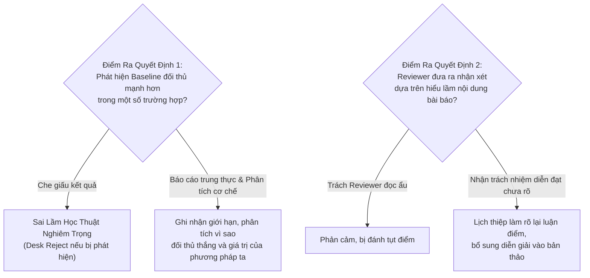

# Quy Trình Soạn Thảo & Phản Biện Bài Báo Khoa Học
# Scientific Paper Review and Writing Workflow

---

## 1. Mục Đích (Purpose)
Quy trình này thiết lập chuẩn mực khoa học và lộ trình thao tác chi tiết dành cho nhà nghiên cứu và AI Research Agent nhằm:
1. **Soạn thảo bản thảo bài báo khoa học (Manuscript Writing):** Truyền tải phát hiện nghiên cứu một cách rõ ràng, chặt chẽ theo cấu trúc kinh điển hình chiếc đồng hồ cát (*Hourglass Model*), đảm bảo mọi tuyên bố đóng góp (*claims*) đều được hậu thuẫn 1:1 bằng bằng chứng thực nghiệm hoặc chứng minh toán học chuẩn xác, tuyệt đối không thổi phồng (*zero overclaiming*).
2. **Thực hiện phản biện đồng cấp khắt khe (Peer Reviewing):** Đánh giá khách quan bản thảo khoa học dựa trên 4 trục chất lượng cốt lõi (*Soundness, Empirical Rigor, Novelty, Clarity*), nhận diện chính xác các lỗi chí mạng (*fatal flaws*) và cung cấp phản hồi mang tính xây dựng.
3. **Quản lý giai đoạn phản biện lại (Rebuttal Management):** Soạn thảo thư phúc đáp khoa học điềm tĩnh, tập trung vào dữ liệu và giải quyết thấu đáo mọi băn khoăn của ban phản biện.

---

## 2. Điều Kiện Tiên Quyết (Preconditions)
- Toàn bộ thực nghiệm định lượng chính, baseline chuẩn, và nghiên cứu bóc tách (*ablation studies*) đã hoàn thành với độ tin cậy thống kê (tối thiểu 3-5 random seeds).
- Phân tích lỗi (*failure analysis*) và khảo sát giới hạn (*limitations*) đã được tài liệu hóa minh bạch.
- Gói tái lập kết quả (*Reproducibility Artifact*) đã được đóng gói và kiểm chứng trong môi trường sandbox độc lập theo `ERPF-AI-WORK-007`.
- Ma trận tổng quan y văn (*Literature Matrix*) đã được cập nhật đầy đủ các công trình liên quan đến thời điểm hiện tại (`ERPF-TOOL-TMP-001`).

---

## 3. Dữ Liệu Đầu Vào (Inputs)
- Nhật ký thực nghiệm hoàn chỉnh (weights, metrics, logs, scripts, hardware configurations).
- Bảng tổng hợp so sánh baselines và ma trận bóc tách (*Ablation Matrix*).
- Ma trận phân tích đối sánh y văn (*Literature Matrix*).
- Quy định định dạng và tiêu chí đánh giá của hội nghị đích (ví dụ: Call for Papers, Author Guidelines, Page Limits, NeurIPS Paper Checklist).

---

## 4. Kết Quả Đầu Ra Kỳ Vọng (Expected Outputs)
1. **Bản Thảo Khoa Học Hoàn Chỉnh (Scientific Manuscript):** Bài báo đạt chuẩn cấu trúc hội nghị (PDF 8-9 trang nội dung chính) kèm sơ đồ trực quan hóa kiến trúc và kết quả thực nghiệm.
2. **Phần Phụ Lục Kỹ Thuật (Supplementary Material / Appendix):** Bổ sung đầy đủ chứng minh lý thuyết, siêu tham số chi tiết, thống kê thời gian chạy/tài nguyên, phân tích lỗi chi tiết và mã nguồn tái lập.
3. **Bản Kiểm Toán Đối Chiếu Tuyên Bố - Bằng Chứng (Claims-to-Evidence Matrix):** Bảng kiểm chứng xác nhận 100% tuyên bố khoa học có bằng chứng tương ứng.
4. **Báo Cáo Phản Biện Đồng Nghiệp Nội Bộ (Mock Review Report):** Đánh giá khách quan theo bảng tiêu chí 4 trục trước khi nộp.
5. **Thư Phúc Đáp Phản Biện (Rebuttal Document):** Soạn thảo trong giai đoạn Author Response (nếu áp dụng).

---

## 5. Các Giai Đoạn Chính (Main Stages)



### Giai Đoạn 1: Lập Khung Lập Luận & Căn Chỉnh Tuyên Bố (Claims-to-Evidence Alignment)
- **Thiết lập bảng ma trận đối chiếu (Claims-to-Evidence Matrix):**
  Liệt kê rõ ràng:
  - Cột 1: Tuyên bố đóng góp (*Claim*).
  - Cột 2: Bằng chứng hỗ trợ trực tiếp (*Direct Evidence* - Bảng nào, Hình nào, Định lý nào).
  - Cột 3: Giả định nền tảng (*Underlying Assumptions*).
  - Cột 4: Giới hạn và ngoại lệ quan sát được (*Boundary Conditions & Failure Cases*).
- **Quy tắc vàng:** Không cho phép bất kỳ câu khẳng định nào trong Abstract hoặc Introduction không có con trỏ trực tiếp đến kết quả định lượng hoặc chứng minh toán học trong bài.

### Giai Đoạn 2: Soạn Thảo Theo Cấu Trúc Chiếc Đồng Hồ Cát (The Hourglass Scientific Writing)
Cấu trúc bài báo bắt đầu từ bối cảnh rộng lớn, thu hẹp dần vào bài toán cụ thể và phương pháp đề xuất, sau đó mở rộng trở lại về tác động thực nghiệm và ý nghĩa khoa học tổng quát:

1. **Title & Abstract (Công thức 5 câu chuẩn mực):**
   - *Câu 1 (Context):* Bối cảnh rộng lớn và tầm quan trọng của lĩnh vực.
   - *Câu 2 (Problem & Limitation):* Lỗ hổng kỹ thuật hoặc giới hạn căn bản của các giải pháp hiện tại (*The Gap*).
   - *Câu 3 (Core Proposal / Key Insight):* Nguyên lý cốt lõi của giải pháp được đề xuất trong công trình này.
   - *Câu 4 (Key Empirical Evidence):* Con số kết quả thực nghiệm đắt giá nhất trên benchmark chuẩn (ví dụ: cải thiện +3.2% accuracy, giảm 40% latency).
   - *Câu 5 (Significance / Impact):* Ý nghĩa của phát hiện đối với cộng đồng nghiên cứu.

2. **Introduction (1.5 - 2 trang):**
   - Đặt vấn đề từ trực giác khoa học sang hình thức hóa bài toán.
   - Chỉ ra tại sao phương pháp trước đây thất bại (thiếu sót về mặt cơ chế, không chỉ đơn thuần là điểm số thấp).
   - Minh họa ý tưởng cốt lõi bằng **Hình 1 (Figure 1: Teaser Figure)** - một sơ đồ trực quan tóm tắt toàn bộ khái niệm mà độc giả nhìn vào hiểu ngay sự khác biệt.
   - Danh sách đóng góp rõ ràng (*Bulleted Contributions* - thường 3 mục): (1) Đóng góp về mô hình/lý thuyết; (2) Phát hiện thực nghiệm hoặc benchmark mới; (3) Cải thiện hiệu năng và cung cấp mã nguồn mở.

3. **Related Work (Khảo sát có cấu trúc theo chủ đề):**
   - Tổ chức theo các cụm chủ đề phương pháp luận, không liệt kê tuần tự theo tác giả.
   - Với mỗi nhóm công trình, nêu rõ: Họ làm gì? Giới hạn của họ là gì? Phương pháp này khác biệt ở điểm then chốt nào?

4. **Methodology / Technical Formulation:**
   - Định nghĩa bài toán toán học (*Problem Formulation*) với ký hiệu rõ ràng, bảng chú giải ký hiệu nếu cần.
   - Mô tả tuần tự từ kiến trúc tổng thể đến từng thành phần chi tiết.
   - Cung cấp mã giả thuật toán (*Pseudocode Algorithm*) chi tiết các bước huấn luyện/suy luận.

5. **Experiments & Empirical Evaluation:**
   - *Môi trường thực nghiệm:* Datasets, metrics, baselines mạnh nhất.
   - *Kết quả chính (Main Results):* Bảng so sánh có độ lệch chuẩn (mean ± std), làm nổi bật kết quả tốt nhất và nhì một cách trung thực.
   - *Nghiên cứu bóc tách (Ablation Studies):* Bóc tách từng thành phần để chứng minh mỗi module đề xuất đều đóng góp giá trị thực sự.
   - *Phân tích định tính & Trực quan hóa:* Trực quan hóa biểu diễn (t-SNE, Attention maps), biểu đồ độ nhạy siêu tham số, phân tích case study thành công và thất bại.

6. **Limitations & Ethical Considerations (Bắt buộc):**
   - Công khai minh bạch chi phí tính toán, độ trễ, các trường hợp mô hình thất bại, điều kiện biên chưa áp dụng được.

7. **Supplementary Material (Appendix):**
   - Toàn bộ chi tiết siêu tham số, chứng minh toán học, tài nguyên phần cứng, giấy phép dữ liệu và phân tích mở rộng.

### Giai Đoạn 3: Tự Kiểm Toán Tính Khách Quan & Giảm Tuyên Bố Quá Đậm (Overclaiming Audit & Hedging)
- **Loại bỏ từ ngữ thổi phồng (*Hype Words*):** Rà soát và gạch bỏ các từ ngữ như *"revolutionary"*, *"unprecedented"*, *"state-of-the-art across all tasks"*, *"flawless"*, *"optimal"*.
- **Kỹ thuật Hedging (Khẳng định có chừng mực):**
  - Thay vì: *"Our method solves the catastophic forgetting problem."*
  - Viết lại: *"Empirical results suggest that our approach substantially mitigates catastrophic forgetting under the evaluated continual learning benchmarks."*
- Kiểm tra tính nhất quán giữa số liệu trong văn bản và số liệu trong bảng biểu/đồ thị.

### Giai Đoạn 4: Quy Trình Phản Biện Đồng Nghiệp Khách Quan (Rigorous Peer Review Protocol)
Khi đóng vai trò là Reviewer (hoặc làm Internal Mock Review):
- Đánh giá bài báo trên 4 trục độc lập:
  1. **Tính Đúng Đắn (Soundness - Trọng số 40%):** Lập luận logic có lỗ hổng không? Chứng minh toán học có lỗi không? Thiết kế thực nghiệm có biến gây nhiễu (*confounding factors*) hay rò rỉ dữ liệu (*data leakage*) không?
  2. **Độ Nghiêm Cẩn Thực Nghiệm (Empirical Rigor - Trọng số 25%):** Baselines có được tinh chỉnh công bằng không? Có báo cáo độ lệch chuẩn qua nhiều seed không? Ablation có cô lập độc lập từng biến không?
  3. **Tính Mới & Ý Nghĩa (Novelty & Significance - Trọng số 20%):** Công trình đóng góp tri thức mới hay chỉ là sự kết hợp cơ học của các thành phần có sẵn? Kết quả có thúc đẩy cộng đồng hay chỉ giải quyết bài toán nhân tạo?
  4. **Độ Rõ Ràng & Khả Năng Tái Lập (Clarity & Reproducibility - Trọng số 15%):** Bài viết có dễ hiểu không? Mã nguồn, siêu tham số và dữ liệu có sẵn sàng để cộng đồng chạy lại không?
- Phân loại rõ ràng giữa:
  - **Lỗi chí mạng (Fatal Flaws):** Lỗ hổng lý thuyết, so sánh thiếu công bằng nghiêm trọng, rò rỉ dữ liệu khiến kết luận sai lệch -> Không thể cứu vãn trong giai đoạn rebuttal ngắn.
  - **Khiếm khuyết nhỏ (Minor Deficiencies):** Thiếu baseline phụ, lỗi chính tả, thiếu một thực nghiệm nhạy cảm nhỏ -> Có thể giải quyết trong rebuttal.

### Giai Đoạn 5: Chiến Lược Phản Hồi Phản Biện (Rebuttal Strategy)
Khi nhận đánh giá từ hội nghị:
- **Tâm thế tiếp nhận:** Chuyên nghiệp, tôn trọng, không tranh cãi cảm tính (*Tone: polite, objective, evidence-driven*).
- **Cấu trúc phúc đáp chuẩn mực:**
  - Lời cảm ơn ban phản biện vì những nhận xét sắc sảo.
  - Điểm đồng thuận chung và bảng tóm tắt các thực nghiệm bổ sung đã thực hiện.
  - Phản hồi chi tiết từng Reviewer (chia theo từng câu hỏi/nhận xét cụ thể).
  - Trích dẫn trực tiếp dữ liệu mới: Bảng số liệu mới, số seed mới, hoặc chỉ rõ trang/dòng trong bài báo đã làm rõ vấn đề.

---

## 6. Điểm Ra Quyết Định Rẽ Nhánh (Decision Points)



- **Quyết Định 1: Xử lý khi phương pháp không đạt SOTA toàn diện:**
  - *Phương án:* Không cố tình chọn lọc kết quả (*cherry-picking*). Định vị lại bài báo từ *"Phương pháp vượt trội mọi mặt"* thành *"Phương pháp mang lại cơ chế cân bằng mới giữa hiệu năng và độ phức tạp/tài nguyên"*.
- **Quyết Định 2: Xử lý khi Reviewer yêu cầu chạy thực nghiệm vượt quá quy mô tài nguyên (ví dụ yêu cầu train trên hàng nghìn GPU):**
  - *Phương án:* Lịch thiệp giải thích giới hạn tài nguyên tính toán thực tế, đồng thời cung cấp thực nghiệm trên tập dữ liệu con (toy dataset / subset) hoặc phân tích độ phức tạp lý thuyết để chứng minh xu hướng mở rộng (*scaling trend*).

---

## 7. Phương Pháp & Kỹ Thuật Áp Dụng (Methods & Techniques)
- **The 5-Sentence Abstract Formula:** Kỹ thuật chưng cất toàn bộ công trình thành 150-200 từ với cấu trúc chặt chẽ.
- **Claims-to-Evidence Matrix:** Phương pháp ánh xạ bảng kiểm chứng khoa học.
- **Hedging & Academic Precision:** Sử dụng từ ngữ chỉ mức độ xác suất hợp lý (`demonstrates`, `indicates`, `suggests`, `under the tested conditions`).
- **NeurIPS / ICLR Paper Checklist:** Danh mục câu hỏi thẩm định trách nhiệm khoa học, khả năng tái lập và đạo đức dữ liệu.
- **Structured Rebuttal Template:** Khuôn mẫu phúc đáp phân đoạn rõ ràng (`Point-by-Point Response with Diff Markers`).

---

## 8. Các Dạng Thất Bại & Sai Lầm Thường Gặp (Common Failure Modes)

| Sai Lầm (Failure Mode) | Biểu Hiện Thực Tế | Hậu Quả & Cách Khắc Phục |
| :--- | :--- | :--- |
| **Thổi Phồng Đóng Góp (Overclaiming)** | Dùng từ ngữ tuyệt đối hóa, tuyên bố giải quyết trọn vẹn bài toán lớn. | Mất uy tín khoa học, reviewer lập tức tìm phản ví dụ để từ chối bài. Khắc phục: Khu biệt điều kiện biên. |
| **Baseline Bù Nhìn (Strawman Baselines)** | So sánh với các mô hình cũ từ 5 năm trước hoặc dùng cài đặt mặc định tồi tệ cho baseline. | Bị gán nhãn *Empirically flawed / Unfair comparison*. Khắc phục: Cập nhật baseline cạnh tranh nhất và tune kỹ. |
| **Liệt Kê Y Văn Tù Mù (Laundry List Related Work)** | *"A did X [1]. B did Y [2]. C did Z [3]."* không có liên kết logic. | Bài viết rời rạc, không làm nổi bật được vị trí của công trình. Khắc phục: Gom cụm theo chủ đề phương pháp luận. |
| **Bỏ Qua Sai Số Ngẫu Nhiên** | Chỉ báo cáo con số cao nhất của 1 lần chạy may mắn duy nhất. | Không thể tái lập, điểm số giả tạo. Khắc phục: Báo cáo trung bình và độ lệch chuẩn của ít nhất 3-5 hạt giống. |
| **Phản Ứng Tự Ái Trong Rebuttal** | Tranh cãi tay đôi, chỉ trích reviewer thiếu hiểu biết. | Chắc chắn bị chấm điểm phạt từ Meta-Reviewer. Khắc phục: Luôn giữ thái độ hòa nhã, tôn trọng và dùng dữ kiện thực nghiệm để thuyết phục. |

---

## 9. Cổng Kiểm Soát Chất Lượng (Quality Checkpoints)

```
[ ] GATE 1: Thẩm định Tuyên Bố & Bằng Chứng (Claims-to-Evidence Match)
    - 100% tuyên bố tại Abstract & Intro đều có số liệu/định lý chứng minh trực tiếp trong bài.
[ ] GATE 2: Tự Kiểm Toán Tính Khách Quan (Overclaiming & Tone Check)
    - Toàn bộ từ ngữ thổi phồng đã được gỡ bỏ; ngôn ngữ mang tính học thuật thận trọng (hedged).
[ ] GATE 3: Kiểm Tra Thống Kê & Bóc Tách (Statistical & Ablation Integrity)
    - Bảng kết quả có đầy đủ độ lệch chuẩn và giải thích rõ ràng cơ chế đóng góp của từng thành phần.
[ ] GATE 4: Hoàn Thiện Bản Tái Lập (Reproducibility Packaging)
    - Đáp ứng trọn vẹn danh mục NeurIPS Reproducibility Checklist và kèm liên kết mã nguồn ẩn danh.
[ ] GATE 5: Diễn Tập Phản Biện Độc Lập (Mock Review Gate)
    - Điểm số tự chấm trên 4 trục đạt ngưỡng an toàn (Soundness >= 7/10, Rigor >= 7/10).
```

---

## 10. Lộ Trình Thay Thế / Thoát Hiểm (Alternative Paths)
- **Khi kết quả thực nghiệm lý thuyết bị phản biện chỉ ra lỗi sai căn bản:**
  - *Lối thoát:* Rút bài (*Withdraw*) ngay lập tức để bảo vệ uy tín học thuật; tuyệt đối không cố chấp lấp liếm bằng các lý lẽ ngụy biện trong rebuttal. Sửa lại lý thuyết và nộp vào chu kỳ hội nghị tiếp theo.
- **Khi phương pháp mới không vượt được SOTA nhưng mang lại phát hiện phân tích sâu sắc:**
  - *Lối thoát:* Tái định vị bài báo thành dạng bài **Phân tích Thực nghiệm hoặc Đánh giá Benchmark (Empirical Analysis / Position Paper)**, tập trung giá trị vào việc mổ xẻ vì sao các phương pháp hiện tại hoạt động và chỉ ra điểm mù của cộng đồng.

---

## 11. Nguyên Lý & Năng Lực Liên Quan (Relevant Principles & Competencies)
- **Nguyên Lý Nền Tảng:**
  - `ERPF-CORE-PRIN-001` (Intellectual Honesty & Evidence-Based Reasoning)
  - `ERPF-CORE-PRIN-002` (Falsifiability & Skepticism)
  - `ERPF-CORE-PRIN-005` (Simplest Sufficient Explanation)
- **Năng Lực Cốt Lõi:**
  - `ERPF-CORE-COMP-003` (Critical Evaluation)
  - `ERPF-CORE-COMP-008` (Technical Communication & Scientific Writing)
  - `ERPF-CORE-COMP-009` (Collaboration & Peer Review)
- **Tạo Tác & Biểu Mẫu Hỗ Trợ:**
  - `ERPF-TOOL-TMP-001` (Literature Matrix Template)
  - `ERPF-TOOL-TMP-003` (Scientific Peer Review Rubric)
