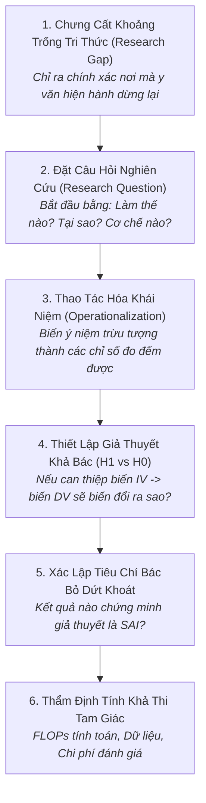

# Quy Trình Định Hình Vấn Đề & Thiết Lập Giả Thuyết Khoa Học
# Research Problem & Falsifiable Hypothesis Formulation Workflow

---

## 1. Mục Đích (Purpose)
Quy trình này hướng dẫn nhà nghiên cứu chuyển hóa một khoảng trống tri thức (Research Gap) đã được xác nhận trong y văn thành một **Câu Hỏi Nghiên Cứu Tường Minh** và một **Giả Thuyết Khoa Học Có Tính Khả Bác (Falsifiable Hypothesis)** theo tiêu chuẩn Karl Popper, đi kèm các định nghĩa thao tác hóa định lượng và đánh giá tính khả thi về tài nguyên tính toán.

---

## 2. Điều Kiện Tiên Quyết (Preconditions)
- Đã hoàn thành quy trình Khảo sát Y văn [`literature-review.md`](file:///home/longtran/Projects/rendez-web/erpf/workflows/ai-research/literature-review.md) và có Ma trận Y văn xác định rõ điểm giới hạn của các phương pháp hiện hành.

---

## 3. Dữ Liệu Đầu Vào (Inputs)
- Bảng tổng hợp các giới hạn y văn từ `literature-matrix.md`.
- Ý tưởng can thiệp kỹ thuật hoặc cơ chế thuật toán dự kiến đề xuất.

---

## 4. Kết Quả Đầu Ra Kỳ Vọng (Expected Outputs)
- **Bản Tuyên Bố Giả Thuyết Khoa Học (Hypothesis Specification Document):**
  1. Câu hỏi nghiên cứu tường minh (Research Question).
  2. Bảng định nghĩa thao tác hóa các biến số (Operational Definitions).
  3. Cặp giả thuyết đối lập: $H_1$ (Giả thuyết nghiên cứu) và $H_0$ (Giả thuyết không).
  4. Tiêu chí bác bỏ dứt khoát (Falsification Criteria).
  5. Đánh giá tính khả thi tam giác (Compute, Data, Evaluation).

---

## 5. Các Giai Đoạn Chính (Main Stages)

### Chi Tiết Từng Giai Đoạn:
- **GĐ 1: Chưng cất khoảng trống:** Tránh nhầm lẫn với cơ hội kỹ thuật (xem [`problem-formulation-and-gaps.md`](file:///home/longtran/Projects/rendez-web/erpf/ai-research/methodology/problem-formulation-and-gaps.md)).
- **GĐ 2: Câu hỏi nghiên cứu:** Không đặt câu hỏi nhị phân đơn giản (Yes/No); đặt câu hỏi về mối quan hệ nhân quả giữa các cơ chế.
- **GĐ 3: Thao tác hóa:** Thay thế các cụm từ mơ hồ như "hiểu tốt hơn" bằng "chỉ số nDCG@10 tăng $\ge 5\%$ trên tập kiểm thử 5,000 truy vấn".
- **GĐ 4: Giả thuyết $H_1$ vs $H_0$:** Xây dựng phát biểu nhân quả có cấu trúc: *Nếu [can thiệp A] thì [kết quả B] bởi vì [cơ chế C]* (xem [`hypothesis-development-and-methodology.md`](file:///home/longtran/Projects/rendez-web/erpf/ai-research/methodology/hypothesis-development-and-methodology.md)).
- **GĐ 5: Tiêu chí bác bỏ:** Ghi rõ điều kiện thất bại. Nếu không có điều kiện nào làm cho giả thuyết bị sai, giả thuyết đó là phi khoa học!
- **GĐ 6: Đánh giá khả thi:** Tính toán tổng số FLOPs $\approx 6ND$ và đối chiếu với số lượng GPU hiện có.

---

## 6. Điểm Ra Quyết Định Rẽ Nhánh (Decision Points & Professional Judgment)

- **Điểm rẽ 1: Kiểm tra tính khả bác (The Falsifiability Test):**
  - Tự hỏi: *"Liệu có tồn tại một kết quả thực nghiệm nào có thể chứng minh tuyên bố này là SAI không?"*
  - Nếu câu trả lời là "KHÔNG" $\rightarrow$ **Giả thuyết bị từ chối ngay lập tức**. Bắt buộc viết lại để có ranh giới đúng/sai định lượng rõ ràng.
- **Điểm rẽ 2: Vượt ngân sách tính toán (Compute Deficit):**
  - Nếu số GPU-giờ ước tính vượt quá 2 lần khả năng của phòng lab $\rightarrow$ **Thu hẹp phạm vi (Re-scoping)**: Chuyển từ tiền huấn luyện từ đầu sang PEFT (LoRA), hoặc giảm độ phân giải dữ liệu.

---

## 7. Phương Pháp & Kỹ Thuật Áp Dụng (Methods & Techniques)
- Tiêu chuẩn Khả bác Karl Popper (Popperian Falsifiability).
- Kỹ thuật Thao tác hóa khái niệm trừu tượng (Operational Definitions).
- Đánh giá khả thi theo Tam giác Tính toán (Compute Feasibility Triangle).

---

## 8. Các Dạng Thất Bại & Sai Lầm Thường Gặp (Common Failure Modes)
- **Phát biểu ngụy biện luôn đúng (Tautology):** Đưa ra phát biểu hiển nhiên: "Mô hình có nhiều tham số hơn và học trên nhiều dữ liệu hơn sẽ đạt điểm cao hơn".
- **Dời cọc gôn (Moving Goalposts):** Thay đổi nội dung giả thuyết sau khi thấy kết quả thực nghiệm không như ý muốn.
- **Biến số không thể đo lường:** Đưa ra các biến số không có thước đo định lượng khách quan.

---

## 9. Cổng Kiểm Soát Chất Lượng (Quality Checkpoints)
- [ ] Giả thuyết có thể bị bác bỏ dứt khoát bằng dữ liệu thực nghiệm.
- [ ] Mọi biến số đều có thước đo định lượng kèm đơn vị cụ thể.
- [ ] Tiêu chí bác bỏ ($H_0$) được xác định bằng ngưỡng thống kê ($p \ge 0.05$).
- [ ] Ngân sách FLOPs và GPU-giờ nằm trong giới hạn tài nguyên được cấp.

---

## 10. Lộ Trình Thay Thế / Thoát Hiểm (Alternative Paths)
- Nếu bài toán quá phức tạp và các biến số đan xen không thể phân lập: **Thực hiện một thực nghiệm thăm dò sơ bộ (Pilot Study)** với quy mô nhỏ để quan sát các phân phối trước khi chốt giả thuyết chính thức.

---

## 11. Nguyên Lý & Năng Lực Liên Quan
- **Nguyên lý cốt lõi:** Problem-First Thinking, Intellectual Honesty, Critical Thinking (`ERPF-CORE-PRIN-001`).
- **Năng lực áp dụng:** C1 (Problem Formulation), C2 (Analytical Reasoning), C3 (Critical Evaluation).
