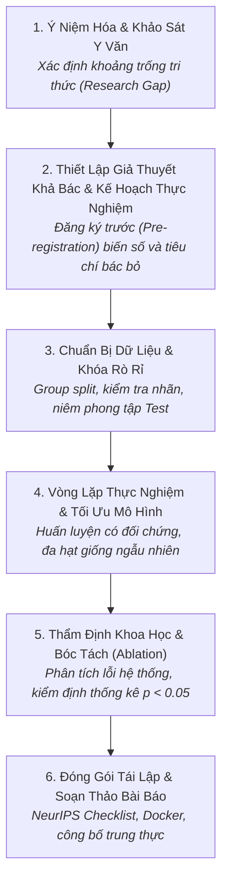

# Chu Trình Nghiên Cứu AI Tổng Thể
# Comprehensive AI Research Lifecycle Workflow

---

## 1. Mục Đích (Purpose)
Quy trình này cung cấp khung điều phối toàn diện cho một dự án nghiên cứu Trí Tuệ Nhân Tạo / Học Máy từ lúc nảy sinh ý tưởng ban đầu, qua khảo sát y văn có hệ thống, thiết lập giả thuyết khả bác, thiết kế thực nghiệm có đối chứng, phân tích lỗi, đến khi công bố bài báo khoa học và mã nguồn có khả năng tái lập hoàn toàn.

---

## 2. Điều Kiện Tiên Quyết (Preconditions)
- Có một vấn đề khoa học hoặc giới hạn công nghệ chưa có lời giải (Research Problem).
- Đã được phê duyệt ngân sách tính toán (Compute budget) và có quyền tiếp cận tập dữ liệu liên quan.

---

## 3. Dữ Liệu Đầu Vào (Inputs)
- Ý tưởng nghiên cứu ban đầu.
- Y văn học thuật liên quan và hạ tầng tính toán (GPU cluster).

---

## 4. Kết Quả Đầu Ra Kỳ Vọng (Expected Outputs)
- Bài báo khoa học hoàn chỉnh đạt chuẩn xuất bản tại các hội nghị đỉnh cao (NeurIPS, ICLR, ACL).
- Kho mã nguồn mở sạch sẽ kèm checkpoint và script tái lập kết quả 1 lệnh (`reproduce.sh`).

---

## 5. Các Giai Đoạn Chính (Main Stages)

### Chi Tiết Từng Giai Đoạn:
- **GĐ 1: Ý niệm & Y văn:** Khảo sát ít nhất 20 bài báo liên quan bằng kỹ thuật Three-Pass; lập Ma trận Y văn (xem [`literature-review.md`](file:///home/longtran/Projects/rendez-web/erpf/workflows/ai-research/literature-review.md)).
- **GĐ 2: Giả thuyết & Kế hoạch:** Xác định giả thuyết $H_1$ và tiêu chí bác bỏ dứt khoát; lập bản kế hoạch thực nghiệm (xem [`experiment-planning-execution.md`](file:///home/longtran/Projects/rendez-web/erpf/workflows/ai-research/experiment-planning-execution.md)).
- **GĐ 3: Dữ liệu an toàn:** Phân tách tập dữ liệu theo nhóm độc lập (Group-aware Split) để loại trừ triệt để Data Leakage (xem [`dataset-analysis-and-leakage.md`](file:///home/longtran/Projects/rendez-web/erpf/ai-research/empirical-loop/dataset-analysis-and-leakage.md)).
- **GĐ 4: Thực nghiệm:** Chạy thực nghiệm có đối chứng, so sánh công bằng với Baseline đã được khớp tham số.
- **GĐ 5: Thẩm định & Bóc tách:** Làm thí nghiệm bóc tách (Ablation) để chứng minh thành phần nào thực sự mang lại kết quả; phân tích 50 ca dự đoán sai nặng nhất.
- **GĐ 6: Công bố:** Soạn bài báo tuân thủ cấu trúc hùng biện; mở kho mã nguồn và checkpoint công khai.

---

## 6. Điểm Ra Quyết Định Rẽ Nhánh (Decision Points & Professional Judgment)

- **Điểm rẽ 1: Khi nào cần HỦY BỎ hoặc ĐỔI HƯỚNG đề tài (Pivot / Kill Decision)?**
  - Nếu sau 3 vòng thực nghiệm nghiêm ngặt có đối chứng mà giả thuyết đối ($H_1$) liên tục bị dữ liệu bác bỏ: **Dừng lại ngay lập tức**. Không cố tình p-hack hoặc lươn lẹo số liệu để cứu vớt ý tưởng sai lầm. Chuyển sang viết báo cáo kết quả phủ định (Negative Result Report) để cảnh báo cộng đồng.
- **Điểm rẽ 2: Quyết định mở hòm kiểm thử (Test Set Unsealing):**
  - Chỉ được phép mở tập kiểm thử đúng một lần duy nhất khi toàn bộ quá trình phát triển mô hình trên tập Validation đã kết thúc hoàn toàn.

---

## 7. Phương Pháp & Kỹ Thuật Áp Dụng (Methods & Techniques)
- Khung phân định 7 khái niệm bản thể luận ([`index.md`](file:///home/longtran/Projects/rendez-web/erpf/ai-research/methodology/index.md)).
- Biểu mẫu Kế hoạch thực nghiệm ([`experiment-plan-template.md`](file:///home/longtran/Projects/rendez-web/erpf/toolkit/templates/experiment-plan-template.md)).
- Kiểm tra tính tái lập theo chuẩn NeurIPS Reproducibility Checklist.

---

## 8. Các Dạng Thất Bại & Sai Lầm Thường Gặp (Common Failure Modes)
- **Thiếu kỷ luật đăng ký trước:** Chạy thí nghiệm trước rồi mới vẽ ra giả thuyết sau (bệnh HARKing).
- **Rò rỉ dữ liệu làm sai lệch kết luận:** Đạt điểm SOTA ảo do tập test bị nhiễm vào tập train.
- **Hội chứng bài báo tiếp thị (Hype Paper):** Tuyên bố cách mạng hóa AI nhưng từ chối chia sẻ mã nguồn và checkpoint.

---

## 9. Cổng Kiểm Soát Chất Lượng (Quality Checkpoints)
- [ ] Giả thuyết nghiên cứu có tính khả bác rõ ràng.
- [ ] Tập Test được niêm phong tuyệt đối trong suốt quá trình phát triển mô hình.
- [ ] Có kết quả thực nghiệm trên ít nhất 3 đến 5 hạt giống ngẫu nhiên kèm độ lệch chuẩn.
- [ ] Mã nguồn và script chạy lại 1 lệnh hoạt động trơn tru trong Docker container độc lập.

---

## 10. Lộ Trình Thay Thế / Thoát Hiểm (Alternative Paths)
- Nếu đề tài gặp bế tắc về mặt lý thuyết nhưng lại tạo ra một tập dữ liệu hoặc benchmark có giá trị thực tế cao: **Chuyển hướng đề tài thành "Dataset & Benchmark Track Paper"**.

---

## 11. Nguyên Lý & Năng Lực Liên Quan
- **Nguyên lý cốt lõi:** Intellectual Honesty, Evidence-Based Reasoning, Reproducibility (`ERPF-CORE-PRIN-001`).
- **Năng lực áp dụng:** C1 (Problem Formulation), C2 (Analytical Reasoning), C7 (Planning), C8 (Communication).
