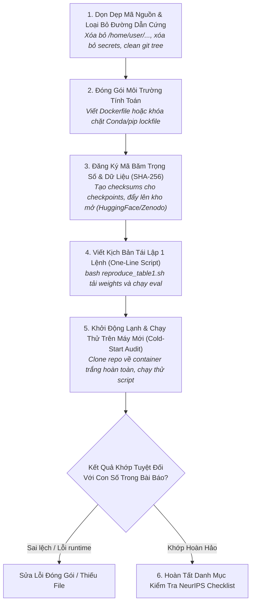

# Quy Trình Đóng Gói & Kiểm Chứng Khả Năng Tái Lập
# Research Reproducibility & Artifact Packaging Workflow

---

## 1. Mục Đích (Purpose)
Quy trình này hướng dẫn nhà nghiên cứu và AI Research Agent thực hiện việc **đóng gói toàn diện và kiểm chứng độc lập khả năng tái lập (Reproducibility Audit)** của một công trình nghiên cứu AI/ML trước khi nộp bài hoặc công bố công khai, đảm bảo bất kỳ ai có máy tính phù hợp đều có thể chạy lại chính xác các kết quả trong bài báo chỉ bằng một câu lệnh duy nhất.

---

## 2. Điều Kiện Tiên Quyết (Preconditions)
- Toàn bộ thực nghiệm chính và nghiên cứu bóc tách đã hoàn thành.
- Các con số xuất hiện trong các bảng biểu và đồ thị của bài báo đã được chốt cố định.

---

## 3. Dữ Liệu Đầu Vào (Inputs)
- Mã nguồn nghiên cứu hoàn chỉnh, các tệp cấu hình YAML, và các tệp checkpoint trọng số mô hình.
- Bản thảo bài báo khoa học chứa các bảng kết quả cần tái lập.

---

## 4. Kết Quả Đầu Ra Kỳ Vọng (Expected Outputs)
- **Kho Lưu Trữ Nghiên Cứu Mở Chuẩn Mực (Reproducible Repository):**
  1. Tệp môi trường tự động (`Dockerfile` hoặc `environment.lock.yml`).
  2. Tệp kịch bản thực thi một lệnh (`reproduce_all.sh`).
  3. Bảng mã băm SHA-256 của toàn bộ tệp trọng số (Checkpoints) và dữ liệu.
  4. Bản xác nhận đáp ứng NeurIPS / ICLR Reproducibility Checklist.

---

## 5. Các Giai Đoạn Chính (Main Stages)

### Chi Tiết Từng Giai Đoạn:
- **GĐ 1: Dọn dẹp repo:** Sử dụng biến môi trường hoặc đường dẫn tương đối; đảm bảo không còn bất kỳ đường dẫn tuyệt đối nào của máy cá nhân.
- **GĐ 2: Môi trường:** Ghi rõ phiên bản Python, CUDA driver, PyTorch và hệ điều hành (xem [`reproducibility-and-provenance.md`](file:///home/longtran/Projects/rendez-web/erpf/ai-research/evaluation-validation/reproducibility-and-provenance.md)).
- **GĐ 3: Checksum:** Tạo tệp `checksums.sha256` để người tải về có thể kiểm chứng tính toàn vẹn của tệp trọng số.
- **GĐ 4: Kịch bản 1 lệnh:** Tạo script tự động: Tải weights $\rightarrow$ nạp dữ liệu test $\rightarrow$ chạy suy luận $\rightarrow$ in ra bảng so sánh kết quả.
- **GĐ 5: Kiểm toán độc lập:** Khởi chạy một Docker container mới toanh không có cache; clone repo về và chạy kịch bản.
- **GĐ 6: Checklist:** Tích chọn đầy đủ các câu hỏi trong NeurIPS Reproducibility Checklist.

---

## 6. Điểm Ra Quyết Định Rẽ Nhánh (Decision Points & Professional Judgment)

- **Điểm rẽ 1: Dữ liệu bị hạn chế quyền riêng tư hoặc bản quyền thương mại:**
  - Nếu không thể công khai toàn bộ tập dữ liệu gốc: **Bắt buộc phải phát hành một Tập Dữ Liệu Giả Lập Thu Nhỏ (Synthetic Mock Dataset)** có cùng schema và định dạng để người khác có thể kiểm tra dòng chảy của mã nguồn và thuật toán đánh giá.
- **Điểm rẽ 2: Kết quả chạy lại có sai số nhỏ ở chữ số thập phân thứ ba:**
  - Nếu sai số là do khác biệt thế hệ GPU (ví dụ: A100 vs V100 do Tensor Core accumulation): Ghi rõ trong tài liệu tái lập ngưỡng dung sai chấp nhận được (Tolerance: $\pm 0.1\%$).

---

## 7. Phương Pháp & Kỹ Thuật Áp Dụng (Methods & Techniques)
- Mã băm mật mã học (SHA-256 Checksums).
- Đóng gói ứng dụng qua Docker Containerization.
- Kỹ thuật kiểm toán khởi động lạnh (Cold-Start Sandbox Audit).
- Khung kiểm tra NeurIPS / ICLR Machine Learning Reproducibility Checklist.

---

## 8. Các Dạng Thất Bại & Sai Lầm Thường Gặp (Common Failure Modes)
- **Đường dẫn cứng máy cá nhân (Hardcoded Paths):** Để lại đường dẫn `C:\Users\John\Desktop\data\` khiến người khác chạy là bị lỗi `FileNotFoundError`.
- **Thư viện không ghim phiên bản:** Cài đặt package mới nhất làm gãy hàm đã bị deprecated.
- **Quên cung cấp script đánh giá:** Chỉ đưa checkpoint lên mạng nhưng không hướng dẫn lệnh nào để tính ra điểm số trong bài báo.

---

## 9. Cổng Kiểm Soát Chất Lượng (Quality Checkpoints)
- [ ] Script `bash reproduce_table1.sh` chạy thành công trên một máy tính mới hoàn toàn mà không cần can thiệp thủ công.
- [ ] Toàn bộ tệp checkpoints đều có mã băm SHA-256 công khai.
- [ ] Tệp `README.md` hướng dẫn rõ ràng cấu hình phần cứng tối thiểu cần thiết.
- [ ] Hoàn thành 100% các mục trong NeurIPS Reproducibility Checklist.

---

## 10. Lộ Trình Thay Thế / Thoát Hiểm (Alternative Paths)
- Nếu mô hình quá lớn (trên 70 tỷ tham số) khiến người bình thường không thể chạy suy luận cục bộ: **Cung cấp API demo trực tuyến hoặc sổ tay Google Colab / Kaggle Notebook có thể chạy ngay bằng 1 click**.

---

## 11. Nguyên Lý & Năng Lực Liên Quan
- **Nguyên lý cốt lõi:** Reproducibility, Intellectual Honesty, Evidence-Based Reasoning (`ERPF-CORE-PRIN-001`).
- **Năng lực áp dụng:** C4 (Information Literacy & Synthesis), C8 (Technical Communication), C10 (Self-Assessment).
