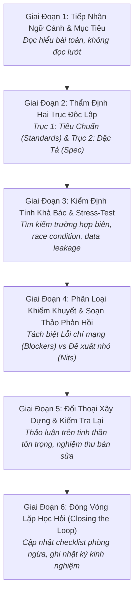

# Quy Trình Phản Biện Phê Phán & Tự Đánh Giá Chuyên Môn
# Critical Review & Self-Assessment Workflow

---

## 1. Mục Đích (Purpose)
Quy trình này cung cấp khung thao tác chuẩn mực để kỹ sư và nhà nghiên cứu thực hiện các hoạt động **đánh giá phản biện đồng cấp (Peer Review) và tự thẩm định năng lực (Self-Assessment)** với tinh thần trung thực trí tuệ, tập trung vào bằng chứng thực nghiệm, loại bỏ định kiến cá nhân và xây dựng văn hóa học hỏi không đổ lỗi.

---

## 2. Điều Kiện Tiên Quyết (Preconditions)
- Có một tạo tác kỹ thuật hoặc học thuật hoàn chỉnh cần thẩm định (Pull Request, bản thảo bài báo khoa học, hoặc báo cáo sự cố production).
- Người đánh giá có đủ ngữ cảnh bài toán và hiểu rõ các tiêu chuẩn nghiệm thu liên quan.

---

## 3. Dữ Liệu Đầu Vào (Inputs)
- Mã nguồn / Bản thảo văn bản / Nhật ký sự cố kèm ngữ cảnh.
- Tiêu chuẩn kỹ thuật áp dụng (`DOCUMENT_STANDARDS.md`, coding standards, hoặc conference rubrics).

---

## 4. Kết Quả Đầu Ra Kỳ Vọng (Expected Outputs)
- **Bản Nhận Xét Phản Biện Kỹ Thuật (Technical Review Report)** chứa các nhận xét mang tính xây dựng, chỉ rõ bằng chứng và đề xuất hành động cụ thể.
- **Tài liệu Phân tích Hậu Sự Cố (Blameless Post-Mortem Document)** nếu là tự đánh giá sau sự cố.

---

## 5. Các Giai Đoạn Chính (Main Stages)

### Chi Tiết Từng Giai Đoạn:
- **GĐ 1: Tiếp nhận ngữ cảnh:** Đọc kỹ mô tả PR hoặc Abstract; nắm vững mục đích trước khi soi chi tiết.
- **GĐ 2: Thẩm định hai trục:** Đảm bảo máy móc (CI/Linters) đã kiểm tra xong Trục 1 (Standards) để con người tập trung vào Trục 2 (Spec, Logic nghiệp vụ, Ranh giới tin cậy).
- **GĐ 3: Stress-test giả định:** Tự hỏi: *"Điều gì sẽ xảy ra nếu đầu vào là rỗng? Nếu có 1,000 request cùng lúc? Nếu mạng bị ngắt giữa chừng?"*.
- **GĐ 4: Soạn phản hồi mang tính xây dựng:** Áp dụng nguyên tắc: Khen ngợi giải pháp tốt $\rightarrow$ Chỉ rõ lỗi logic kèm bằng chứng $\rightarrow$ Đưa ra đề xuất cải thiện cụ thể.
- **GĐ 5: Đối thoại:** Tôn trọng quyền tự chủ của tác giả; phân biệt giữa quy tắc bắt buộc và quan điểm cá nhân.
- **GĐ 6: Học hỏi:** Sau sự cố hoặc review khó, cập nhật quy trình hoặc checklist để lỗi đó không bao giờ tái diễn.

---

## 6. Điểm Ra Quyết Định Rẽ Nhánh (Decision Points & Professional Judgment)

- **Điểm rẽ 1: Phân loại khiếm khuyết:**
  - *Lỗi chí mạng (Blocker):* Rò rỉ bảo mật, phá vỡ bất biến dữ liệu, race condition, data leakage $\rightarrow$ Bắt buộc **Request Changes**, không cho phép merge.
  - *Ý kiến cải thiện phong cách (Nitpick / Suggestion):* Đặt tên biến hay hơn, tái cấu trúc nhỏ $\rightarrow$ Đánh dấu rõ `[Non-blocking / Nit]` và cho phép tác giả tự quyết định.
- **Điểm rẽ 2: Khi nào cần nâng cấp lên cuộc họp trao đổi trực tiếp?**
  - Nếu sau 2 lượt trao đổi bằng văn bản mà hai bên vẫn chưa thống nhất: Dừng gõ comment và gọi điện thoại/gặp trực tiếp trong 10 phút để giải quyết hiểu lầm.

---

## 7. Phương Pháp & Kỹ Thuật Áp Dụng (Methods & Techniques)
- Quy trình Thẩm định mã nguồn hai trục (Two-Axis Code Review - xem [`software-quality-and-governance.md`](file:///home/longtran/Projects/rendez-web/erpf/software-engineering/implementation-quality/software-quality-and-governance.md)).
- Biểu mẫu phản biện đồng cấp bài báo khoa học ([`peer-review-rubric-template.md`](file:///home/longtran/Projects/rendez-web/erpf/toolkit/templates/peer-review-rubric-template.md)).
- Phương pháp phân tích nguyên nhân gốc không đổ lỗi (Blameless Post-Mortem qua 5 Whys).

---

## 8. Các Dạng Thất Bại & Sai Lầm Thường Gặp (Common Failure Modes)
- **Review kiểu đóng dấu mù quáng (Rubber-Stamping / "LGTM"):** Nhìn qua loa rồi approve trong 30 giây mà không đọc code.
- **Bới lông tìm vết phong cách (Style Nitpicking):** Tranh cãi về dấu phẩy hoặc thụt lề thay vì kiểm tra logic.
- **Công kích cá nhân (Ad Hominem):** Nhận xét thô lỗ ("Code này viết dở quá") thay vì tập trung vào đoạn mã cụ thể.
- **Tâm lý phòng thủ tiêu cực (Defensiveness):** Coi nhận xét phản biện là sự chỉ trích bản thân thay vì cơ hội hoàn thiện sản phẩm.

---

## 9. Cổng Kiểm Soát Chất Lượng (Quality Checkpoints)
- [ ] Nhận xét chỉ rõ tệp tin, dòng mã hoặc trang cụ thể đi kèm lý do kỹ thuật.
- [ ] Phân định rõ ràng giữa yêu cầu bắt buộc sửa và gợi ý tùy chọn.
- [ ] Toàn bộ các câu hỏi chất vấn đều nhận được câu trả lời thỏa đáng trước khi Approve.

---

## 10. Lộ Trình Thay Thế / Thoát Hiểm (Alternative Paths)
- Nếu người phản biện không đủ chuyên môn để đánh giá một phần kỹ thuật hẹp (ví dụ: thuật toán mật mã hoặc kernel CUDA): **Thành thật từ chối phần đó (Abstain)** và mời chuyên gia phù hợp tham gia review.

---

## 11. Nguyên Lý & Năng Lực Liên Quan
- **Nguyên lý cốt lõi:** Intellectual Honesty, Critical Thinking, Evidence-Based Reasoning (`ERPF-CORE-PRIN-001`).
- **Năng lực áp dụng:** C3 (Critical Evaluation), C9 (Collaboration & Peer Review), C10 (Self-Assessment).
