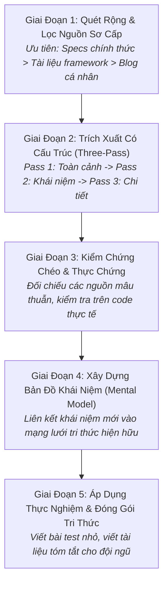

# Quy Trình Tiếp Thu & Tổng Hợp Tri Thức Kỹ Thuật
# Knowledge Acquisition & Synthesis Workflow

---

## 1. Mục Đích (Purpose)
Quy trình này hướng dẫn kỹ sư và nhà nghiên cứu phương pháp tiếp cận, thẩm định và tổng hợp tri thức từ một miền kỹ thuật hoặc học thuật mới một cách **nhanh chóng, có chọn lọc, dựa trên nguồn sơ cấp đáng tin cậy và chuyển hóa thành mô hình nhận thức có khả năng ứng dụng thực tế**, tránh rơi vào bẫy học vẹt hoặc lướt qua bề mặt.

---

## 2. Điều Kiện Tiên Quyết (Preconditions)
- Đã xác định rõ mục tiêu cần tìm hiểu (cần học để giải quyết bài toán cụ thể nào).
- Có quyền truy cập vào các nguồn tài nguyên đáng tin cậy (Tài liệu chính thức, bài báo học thuật, mã nguồn chuẩn).

---

## 3. Dữ Liệu Đầu Vào (Inputs)
- Từ khóa tìm kiếm, tài liệu API, thông số kỹ thuật (RFC/Specs), bài báo khoa học liên quan.

---

## 4. Kết Quả Đầu Ra Kỳ Vọng (Expected Outputs)
- **Tài liệu Tổng Hợp Nhận Thức (Knowledge Synthesis / Guide):** Bao gồm sơ đồ khái niệm (Concept Map), bảng thuật ngữ chuẩn hóa (Glossary), và các đoạn mã minh họa tối thiểu (Executable Snippets).

---

## 5. Các Giai Đoạn Chính (Main Stages)

### Chi Tiết Từng Giai Đoạn:
- **GĐ 1: Quét rộng & Lọc nguồn:** Loại bỏ ngay các bài viết "SEO rác" hoặc hướng dẫn sơ sài trên mạng. Tập trung vào: Tài liệu kiến trúc chính thức, RFC chuẩn, bài báo gốc, và mã nguồn mở của các dự án lớn.
- **GĐ 2: Trích xuất 3 bước:** Áp dụng kỹ thuật Three-Pass (xem [`literature-review-and-synthesis.md`](file:///home/longtran/Projects/rendez-web/erpf/ai-research/methodology/literature-review-and-synthesis.md)).
- **GĐ 3: Kiểm chứng chéo:** Nếu tài liệu nói thư viện hỗ trợ tính năng $X$, hãy mở mã nguồn của thư viện ra đọc hoặc viết một bài test nhỏ để chứng minh tính năng $X$ thực sự hoạt động như mô tả.
- **GĐ 4: Bản đồ khái niệm:** Xác định các bất biến, các đối tượng thực thể và mối quan hệ giữa chúng.
- **GĐ 5: Đóng gói:** Chuyển hóa thành tài liệu hướng dẫn nội bộ hoặc ghi vào sổ tay kỹ thuật.

---

## 6. Điểm Ra Quyết Định Rẽ Nhánh (Decision Points & Professional Judgment)

- **Điểm rẽ 1: Khi nào cần chuyển từ "Đọc tài liệu" sang "Thử nghiệm mã nguồn"?**
  - *Quy tắc 30/70:* Dành tối đa 30% thời gian đọc tài liệu lý thuyết; 70% thời gian còn lại phải dành cho việc viết mã thực nghiệm (Spike/Prototype) để kiểm chứng giả định trong môi trường thực tế.
- **Điểm rẽ 2: Khi nào tri thức được coi là "Đủ dùng" để bắt đầu công việc?**
  - Khi bạn đã nắm được: (1) Cách thức hoạt động bình thường (Happy path); (2) Ranh giới giới hạn và điểm thất bại; (3) Cách xử lý lỗi cơ bản. Không cần phải học thuộc lòng toàn bộ API trước khi bắt đầu.

---

## 7. Phương Pháp & Kỹ Thuật Áp Dụng (Methods & Techniques)
- Kỹ thuật đọc Three-Pass của S. Keshav.
- Ma trận tổng hợp y văn ([`literature-matrix-template.md`](file:///home/longtran/Projects/rendez-web/erpf/toolkit/templates/literature-matrix-template.md)).
- Bản đồ khái niệm (Concept Mapping) và Biểu đồ Mermaid.

---

## 8. Các Dạng Thất Bại & Sai Lầm Thường Gặp (Common Failure Modes)
- **Cái bẫy xem hướng dẫn vô tận (Tutorial Hell):** Xem hàng chục video hướng dẫn nhưng không bao giờ tự gõ code hoặc giải quyết bài toán thực tế.
- **Tin tưởng mù quáng vào blog thứ cấp:** Tiếp nhận các thông tin sai lệch hoặc lỗi thời từ các bài viết không rõ nguồn gốc mà không đối chiếu với tài liệu chính thức.
- **Lạc lối trong chi tiết vụn vặt:** Mất hàng giờ tìm hiểu các cờ cấu hình hiếm gặp trước khi nắm được kiến trúc tổng thể.

---

## 9. Cổng Kiểm Soát Chất Lượng (Quality Checkpoints)
- [ ] Mọi kiến thức cốt lõi đều được dẫn chiếu từ tài liệu sơ cấp (Primary Sources).
- [ ] Đã có ít nhất một đoạn mã thực nghiệm kiểm chứng tính đúng đắn trên môi trường cục bộ.
- [ ] Bản tóm tắt giải thích được cơ chế hoạt động bằng ngôn ngữ của chính mình (Feynman Technique).

---

## 10. Lộ Trình Thay Thế / Thoát Hiểm (Alternative Paths)
- Nếu tài liệu chính thức quá sơ sài hoặc khó hiểu: **Tìm kiếm các tệp kiểm thử (Test files) trong chính kho mã nguồn của thư viện đó**. Test code chính là tài liệu hướng dẫn sử dụng chính xác và trung thực nhất!

---

## 11. Nguyên Lý & Năng Lực Liên Quan
- **Nguyên lý cốt lõi:** Evidence-Based Reasoning, First Principles Thinking, Intellectual Honesty (`ERPF-CORE-PRIN-001`).
- **Năng lực áp dụng:** C4 (Information Literacy & Synthesis), C2 (Analytical Reasoning), C10 (Self-Assessment & Continuous Learning).
