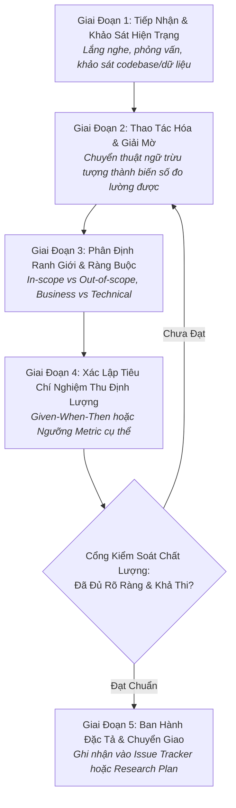

# Quy Trình Định Hình & Thấu Hiểu Bài Toán
# Problem Understanding & Formulation Workflow

---

## 1. Mục Đích (Purpose)
Quy trình này cung cấp phương pháp luận có cấu trúc nhằm chuyển hóa một nhu cầu nghiệp vụ mơ hồ hoặc một hiện tượng kỹ thuật chưa rõ ràng thành một **Vấn Đề Kỹ Thuật / Nghiên Cứu Tường Minh**, có ranh giới xác định, có tiêu chí nghiệm thu định lượng và đã được thẩm định tính khả thi trước khi tiêu tốn nguồn lực lập trình hoặc tính toán.

---

## 2. Điều Kiện Tiên Quyết (Preconditions)
- Có yêu cầu từ người dùng/stakeholder hoặc quan sát thấy một hiện tượng bất thường trong hệ thống.
- Kỹ sư/nhà nghiên cứu đã có quyền truy cập vào tài liệu nghiệp vụ, kho mã nguồn hoặc dữ liệu sơ bộ.

---

## 3. Dữ Liệu Đầu Vào (Inputs)
- Mô tả bài toán ban đầu (User request, bug report, product brief, hoặc research prompt).
- Bối cảnh ràng buộc hiện tại: Ngân sách thời gian, tài nguyên máy chủ/GPU, và các hệ thống phụ thuộc.

---

## 4. Kết Quả Đầu Ra Kỳ Vọng (Expected Outputs)
- **Tài liệu Đặc tả Bài toán (Problem Specification Document)** chứa:
  1. Tuyên bố vấn đề (Problem Statement) không chứa giải pháp định kiến.
  2. Định nghĩa thao tác hóa (Operational Definitions) của các thuật ngữ mập mờ.
  3. Tiêu chí nghiệm thu định lượng (Acceptance Criteria / Success Metrics).
  4. Ranh giới Trong phạm vi (In-Scope) và Ngoài phạm vi (Out-of-Scope).

---

## 5. Các Giai Đoạn Chính (Main Stages)

### Chi Tiết Từng Giai Đoạn:
- **GĐ 1: Tiếp nhận & Khảo sát:** Đọc kỹ yêu cầu gốc; kiểm tra xem bài toán này đã từng được giải quyết trong repo chưa (xem [`codebase-understanding.md`](file:///home/longtran/Projects/rendez-web/erpf/software-engineering/architecture-design/codebase-understanding.md)).
- **GĐ 2: Thao tác hóa:** Loại bỏ các tính từ cảm tính ("nhanh hơn", "thông minh hơn", "đẹp hơn"). Thay thế bằng các định nghĩa có thể đo đếm được (xem [`problem-formulation-and-gaps.md`](file:///home/longtran/Projects/rendez-web/erpf/ai-research/methodology/problem-formulation-and-gaps.md)).
- **GĐ 3: Ranh giới & Ràng buộc:** Vạch rõ ranh giới nổ (Blast Radius); chỉ rõ những gì hệ thống KHÔNG làm trong pha này để chống phình phạm vi (Scope Creep).
- **GĐ 4: Tiêu chuẩn nghiệm thu:** Xây dựng các ca kiểm thử chấp nhận (Acceptance Tests) theo mẫu Given-When-Then.
- **GĐ 5: Phê duyệt:** Thống nhất văn bản với các bên liên quan trước khi gõ dòng code đầu tiên.

---

## 6. Điểm Ra Quyết Định Rẽ Nhánh (Decision Points & Professional Judgment)

- **Điểm rẽ 1: Đây là Cơ Hội Kỹ Thuật (Engineering Task) hay Khoảng Trống Nghiên Cứu (Research Gap)?**
  - *Nếu là Cơ hội kỹ thuật:* Chuyển sang Quy trình Phát triển Phần mềm [`software-development-lifecycle.md`](file:///home/longtran/Projects/rendez-web/erpf/workflows/software-engineering/software-development-lifecycle.md).
  - *Nếu là Khoảng trống nghiên cứu:* Chuyển sang Quy trình Định hình Giả thuyết AI [`problem-hypothesis-formulation.md`](file:///home/longtran/Projects/rendez-web/erpf/workflows/ai-research/problem-hypothesis-formulation.md).
- **Điểm rẽ 2: Bài toán có khả thi trong ràng buộc hiện tại không?**
  - Nếu ước tính chi phí vượt quá ngân sách (thời gian hoặc GPU): Thực hiện đàm phán thu hẹp phạm vi (De-scoping) ngay lập tức, không cố gắng "làm đại".

---

## 7. Phương Pháp & Kỹ Thuật Áp Dụng (Methods & Techniques)
- Kỹ thuật 5 Whys truy tìm nguyên nhân gốc rễ (Root Cause Analysis).
- Khung mục tiêu SMART (Specific, Measurable, Achievable, Relevant, Time-bound).
- Bounded Contexts trích xuất từ Domain-Driven Design (DDD).

---

## 8. Các Dạng Thất Bại & Sai Lầm Thường Gặp (Common Failure Modes)
- **Vội vã nhảy vào giải pháp (Solution Bias):** Lập tức chọn công nghệ (như Microservices hoặc Transformer) trước khi hiểu thấu đáo bản chất bài toán.
- **Chấp nhận yêu cầu mập mờ:** Bắt đầu làm việc khi tiêu chí nghiệm thu chưa được định lượng, dẫn đến tranh cãi bất tận lúc bàn giao.
- **Phình to phạm vi (Scope Bloat):** Cố gắng giải quyết mọi vấn đề của thế giới trong một tính năng duy nhất.

---

## 9. Cổng Kiểm Soát Chất Lượng (Quality Checkpoints)
- [ ] Tuyên bố vấn đề hoàn toàn độc lập với công nghệ giải pháp.
- [ ] Mọi thuật ngữ trừu tượng đều có định nghĩa thao tác hóa.
- [ ] Tiêu chí nghiệm thu có thể kiểm chứng tự động bằng test suite hoặc benchmark script.
- [ ] Danh sách Out-of-Scope được xác định rõ ràng.

---

## 10. Lộ Trình Thay Thế / Thoát Hiểm (Alternative Paths)
- Nếu sau 2 vòng làm rõ mà bài toán vẫn quá mơ hồ hoặc các bên liên quan có xung đột lợi ích không thể dung hòa: **Tạm dừng công việc (Halt & Escalate)**, tổ chức buổi làm việc trực tiếp (Spike / Alignment Session) để thống nhất ưu tiên kinh doanh trước khi tiếp tục.

---

## 11. Nguyên Lý & Năng Lực Liên Quan
- **Nguyên lý cốt lõi:** Problem-First Thinking (`ERPF-CORE-PRIN-001`), Simplest Sufficient Solution.
- **Năng lực áp dụng:** C1 (Problem Formulation), C4 (Information Literacy), C8 (Technical Communication).
