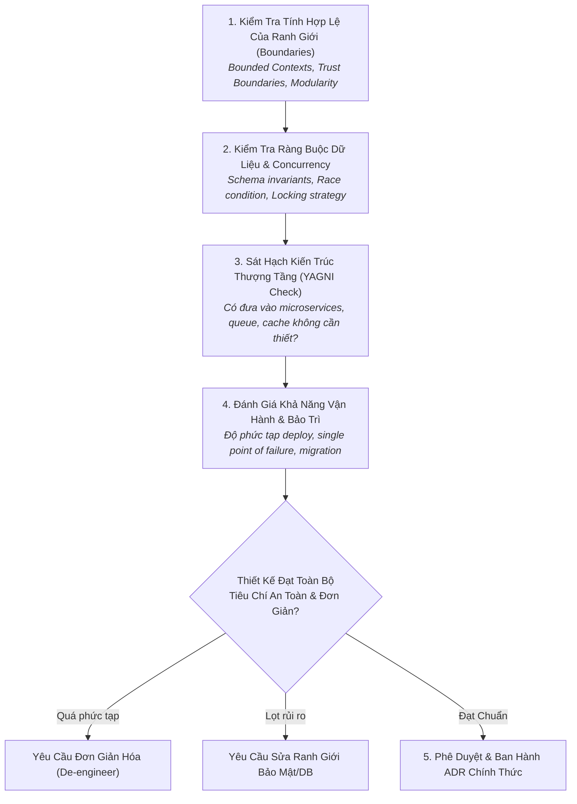

# Quy Trình Thẩm Định Kiến Trúc & Thiết Kế Phần Mềm
# Architecture & Technical Design Review Workflow

---

## 1. Mục Đích (Purpose)
Quy trình này hướng dẫn việc đánh giá phản biện một bản đề xuất kiến trúc hoặc thiết kế kỹ thuật lớn (RFC / Design Doc) nhằm đảm bảo hệ thống đạt tính **kết dính cao, ghép nối lỏng, bảo vệ ranh giới tin cậy, không lãng phí tài nguyên vận hành và kiên quyết loại trừ kiến trúc thượng tầng (Over-engineering)**.

---

## 2. Điều Kiện Tiên Quyết (Preconditions)
- Tác giả đã hoàn thành bản dự thảo thiết kế kỹ thuật (RFC / Technical Design Proposal).
- Đã xác định rõ các yêu cầu chức năng (FRs) và phi chức năng (NFRs / SLOs).

---

## 3. Dữ Liệu Đầu Vào (Inputs)
- Tài liệu đề xuất thiết kế kèm sơ đồ kiến trúc (Mermaid / C4 model).
- Bảng ma trận so sánh các phương án đã xem xét (ADR draft).

---

## 4. Kết Quả Đầu Ra Kỳ Vọng (Expected Outputs)
- **Bản Đánh Giá Thẩm Định Thiết Kế (Design Review Assessment):** Phê duyệt (Approved), Yêu cầu đơn giản hóa (Request Simplification), hoặc Từ chối (Rejected) kèm lý do kỹ thuật chi tiết.

---

## 5. Các Giai Đoạn Chính (Main Stages)

### Chi Tiết Từng Giai Đoạn:
- **GĐ 1: Ranh giới & Ghép nối:** Kiểm tra xem các mô-đun có độc lập không? Có phụ thuộc vòng (Circular Dependency) không? Giao diện có thuộc dạng Deep Module (giao diện hẹp, công năng sâu) không? (xem [`software-design.md`](file:///home/longtran/Projects/rendez-web/erpf/software-engineering/architecture-design/software-design.md)).
- **GĐ 2: Dữ liệu & Tranh chấp:** Kiểm tra xem các bất biến toàn vẹn có được bảo vệ ở tầng DB (`UniqueConstraint`) hay chỉ dựa vào code? Cơ chế khóa (`select_for_update`) đã đủ an toàn chưa?
- **GĐ 3: Thử thách YAGNI (You Aren't Gonna Need It):** Đặt câu hỏi chất vấn: *"Tại sao không thể giải quyết bài toán này bằng một bảng PostgreSQL đơn giản và một truy vấn có index?"*.
- **GĐ 4: Khả năng vận hành:** Đánh giá độ trễ mạng, chi phí hạ tầng và quy trình rollback khi triển khai thất bại.
- **GĐ 5: Phê duyệt:** Ghi nhận quyết định vào hồ sơ ADR.

---

## 6. Điểm Ra Quyết Định Rẽ Nhánh (Decision Points & Professional Judgment)

- **Điểm rẽ 1: Đề xuất tách một dịch vụ riêng (Microservice) có chính đáng?**
  - *Bộ lọc kiểm tra:* Đội ngũ có trên 50 kỹ sư không? Tốc độ triển khai có bị nghẽn thực sự do xung đột merge code không? Yêu cầu công nghệ có thực sự bắt buộc dùng ngôn ngữ khác không?
  - Nếu câu trả lời là "KHÔNG" $\rightarrow$ **Bác bỏ đề xuất Microservices**. Bắt buộc giữ kiến trúc Clean Monolith (xem [`software-architecture.md`](file:///home/longtran/Projects/rendez-web/erpf/software-engineering/architecture-design/software-architecture.md)).
- **Điểm rẽ 2: Thêm tầng Caching (Redis) có bắt buộc ngay từ đầu?**
  - Nếu câu truy vấn cơ sở dữ liệu chưa được đánh index và chưa được tối ưu hóa: **Bác bỏ thêm Cache**. Bắt buộc tối ưu hóa câu truy vấn SQL trước.

---

## 7. Phương Pháp & Kỹ Thuật Áp Dụng (Methods & Techniques)
- Nguyên tắc Mô-đun sâu (Deep Modules của John Ousterhout).
- Khung phân tích ranh giới tin cậy (Trust Boundaries & Zero-Trust).
- Đánh giá đánh đổi Monolith vs Microservices.

---

## 8. Các Dạng Thất Bại & Sai Lầm Thường Gặp (Common Failure Modes)
- **Hội chứng kiến trúc thượng tầng (Over-Engineering Disease):** Thiết kế hệ thống chịu tải 1,000,000 QPS với Kafka, gRPC và Kubernetes cho một sản phẩm nội bộ phục vụ 50 người dùng.
- **Ranh giới mỏng dính (Shallow Interfaces):** Tạo ra hàng chục tầng class trung gian chỉ làm nhiệm vụ chuyển tiếp tham số mà không thêm bất kỳ giá trị logic nào.
- **Bỏ quên Race Conditions:** Phê duyệt một luồng thanh toán hoặc đặt chỗ mà không có cơ chế khóa dòng dữ liệu trong DB.

---

## 9. Cổng Kiểm Soát Chất Lượng (Quality Checkpoints)
- [ ] Không có phụ thuộc vòng giữa các mô-đun hoặc các Django apps.
- [ ] Mọi bất biến nghiệp vụ cốt lõi đều được bảo vệ bằng ràng buộc cấp DB.
- [ ] Số lượng công nghệ mới đưa vào không vượt quá 1 "Innovation Token".
- [ ] Đã có kế hoạch rollback migration không gây gián đoạn dịch vụ (Zero-Downtime).

---

## 10. Lộ Trình Thay Thế / Thoát Hiểm (Alternative Paths)
- Nếu bản thiết kế quá đồ sộ và tiềm ẩn nhiều rủi ro không thể đánh giá hết trên giấy: **Yêu cầu triển khai theo mô hình Cây Si (Strangler Fig Pattern)** — bắt đầu từ một tính năng nhỏ độc lập để kiểm chứng trước khi nhân rộng.

---

## 11. Nguyên Lý & Năng Lực Liên Quan
- **Nguyên lý cốt lõi:** Simplest Sufficient Solution, Systems Thinking, Trade-off Analysis (`ERPF-CORE-PRIN-001`).
- **Năng lực áp dụng:** C5 (Technical Decision-Making), C6 (Systems Thinking), C3 (Critical Evaluation).
