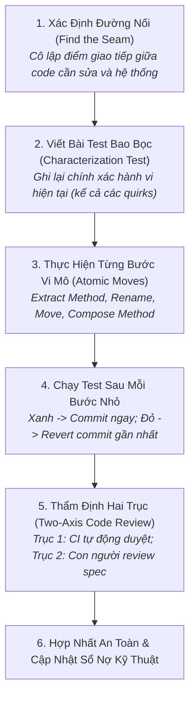

# Quy Trình Review Mã Nguồn & Tái Cấu Trúc An Toàn
# Code Review & Safe Refactoring Workflow

---

## 1. Mục Đích (Purpose)
Quy trình này hướng dẫn kỹ sư và AI Coding Agent thực hiện việc **tái cấu trúc mã nguồn an toàn (Safe Refactoring)** — thay đổi cấu trúc bên trong của phần mềm để làm cho nó dễ đọc, dễ kiểm thử và dễ mở rộng hơn mà **tuyệt đối không làm thay đổi hành vi có thể quan sát được bên ngoài**, kết hợp với quy trình **thẩm định mã nguồn hai trục (Two-Axis Code Review)** có tính xây dựng cao.

---

## 2. Điều Kiện Tiên Quyết (Preconditions)
- Khối mã nguồn cần tái cấu trúc đã được bảo vệ bằng một bộ kiểm thử tự động (hoặc bắt buộc phải viết bài test bao bọc trước khi bắt đầu).
- Hệ thống đang ở trạng thái sạch (Git clean tree) và toàn bộ bài test hiện hữu đều Pass.

---

## 3. Dữ Liệu Đầu Vào (Inputs)
- Đoạn mã nguồn chứa code smell hoặc nợ kỹ thuật cần xử lý.
- Bộ test hiện có hoặc yêu cầu tái cấu trúc từ Technical Debt Backlog.

---

## 4. Kết Quả Đầu Ra Kỳ Vọng (Expected Outputs)
- Mã nguồn mới có tính hiển nhiên cao, độ phức tạp chu trình giảm, không có code trùng lặp.
- 100% bài test vượt qua, không làm gãy bất kỳ API client hay bất biến dữ liệu nào.

---

## 5. Các Giai Đoạn Chính (Main Stages)

### Chi Tiết Từng Giai Đoạn:
- **GĐ 1: Tìm đường nối:** Xác định chính xác hàm hoặc interface là ranh giới tiếp xúc của module (xem [`implementation-practices.md`](file:///home/longtran/Projects/rendez-web/erpf/software-engineering/implementation-quality/implementation-practices.md)).
- **GĐ 2: Test bao bọc:** Nếu đoạn code cũ chưa có test, viết bài test kiểm tra các kịch bản input/output thực tế hiện tại để làm "lưới bảo hiểm".
- **GĐ 3: Thao tác vi mô:** Áp dụng các bước tái cấu trúc nguyên tử của Martin Fowler. Mỗi lần chỉ làm một việc (ví dụ: chỉ trích xuất hàm, không vừa trích xuất hàm vừa đổi logic).
- **GĐ 4: Kỷ luật commit:** Chạy test liên tục sau mỗi 5 phút sửa code. Nếu test pass, commit ngay. Nếu test fail và không sửa được trong 2 phút, revert ngay lập tức!
- **GĐ 5: Review hai trục:** Đảm bảo PR nhỏ hơn 400 dòng; phân tách riêng giữa commit tái cấu trúc và commit thêm tính năng mới (xem [`software-quality-and-governance.md`](file:///home/longtran/Projects/rendez-web/erpf/software-engineering/implementation-quality/software-quality-and-governance.md)).

---

## 6. Điểm Ra Quyết Định Rẽ Nhánh (Decision Points & Professional Judgment)

- **Điểm rẽ 1: Có được phép trộn lẫn Refactoring và Thêm Tính Năng Mới trong cùng 1 PR?**
  - **TUYỆT ĐỐI KHÔNG!** Đây là nguyên tắc vàng. Luôn tách thành 2 PR riêng biệt:
    - *PR 1:* Thuần túy tái cấu trúc (Hành vi giữ nguyên 100%, test cũ pass 100%).
    - *PR 2:* Bổ sung tính năng mới trên nền tảng code đã được làm sạch.
- **Điểm rẽ 2: Khi nào áp dụng Quy tắc Hướng đạo sinh (Boy Scout Rule)?**
  - Khi bạn vào sửa một file để fix bug nhỏ: Dành thêm 10 phút đổi tên một biến mập mờ hoặc xóa một hàm không còn ai dùng. Nếu việc tái cấu trúc tốn hơn 1 giờ $\rightarrow$ Tạo ticket nợ kỹ thuật riêng, không làm lan man.

---

## 7. Phương Pháp & Kỹ Thuật Áp Dụng (Methods & Techniques)
- Kỹ thuật Tái cấu trúc qua đường nối (Refactoring via Seams).
- Kiểm thử bao bọc hành vi (Characterization Testing).
- Quy chuẩn Thẩm định mã nguồn hai trục (Two-Axis Code Review).
- Quy tắc Hướng đạo sinh (Boy Scout Rule).

---

## 8. Các Dạng Thất Bại & Sai Lầm Thường Gặp (Common Failure Modes)
- **Tái cấu trúc kiểu Big-Bang:** Mở 50 file ra sửa cùng lúc mà không có test bảo vệ, sau đó không thể merge và phải vứt bỏ toàn bộ công sức.
- **Vô tình thay đổi hành vi nghiệp vụ:** Đổi kiểu dữ liệu từ float sang int hoặc đổi cách sắp xếp danh sách khiến client bên ngoài bị lỗi ngầm.
- **Gọt đẽo quá đà (Over-Refactoring):** Tạo ra 10 tầng interface trừu tượng cho một logic chỉ dùng đúng 1 lần.

---

## 9. Cổng Kiểm Soát Chất Lượng (Quality Checkpoints)
- [ ] 100% các bài test bao bọc hành vi đều vượt qua.
- [ ] PR không chứa bất kỳ thay đổi nào về hành vi nghiệp vụ hoặc thay đổi hợp đồng API.
- [ ] Kích thước PR dưới 400 dòng thay đổi.
- [ ] Các linter và static type checker đều vượt qua 100%.

---

## 10. Lộ Trình Thay Thế / Thoát Hiểm (Alternative Paths)
- Nếu đoạn code cũ quá nát và quá đan xen (Spaghetti code) không thể tìm thấy đường nối để tái cấu trúc tại chỗ: **Sử dụng Chiến lược Cây Si (Strangler Fig Pattern)** — viết một module mới song song hoàn toàn và chuyển dần từng phần lưu lượng qua.

---

## 11. Nguyên Lý & Năng Lực Liên Quan
- **Nguyên lý cốt lõi:** Simplest Sufficient Solution, Intellectual Honesty (`ERPF-CORE-PRIN-001`).
- **Năng lực áp dụng:** C9 (Collaboration & Peer Review), C1 (Problem Formulation), C10 (Self-Assessment).
