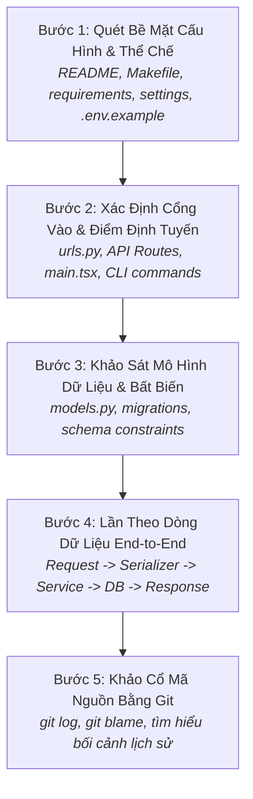

# Quy Trình Khám Phá & Định Hướng Codebase Lạ
# Codebase Exploration & Architecture Discovery Workflow

---

## 1. Mục Đích (Purpose)
Quy trình này cung cấp phương pháp luận 5 bước để kỹ sư hoặc AI Coding Agent nhanh chóng định hướng, thấu hiểu kiến trúc tổng thể, truy vết dòng dữ liệu và xác định các năng lực hiện hữu của một repository mới **mà không làm xáo trộn mã nguồn, không suy diễn sai lệch ý định thiết kế và không viết lại những gì hệ thống đã có sẵn**.

---

## 2. Điều Kiện Tiên Quyết (Preconditions)
- Có quyền truy cập đọc (Read-only access) vào kho mã nguồn và lịch sử Git của repository.
- Kiểm tra `git status` đảm bảo cây thư mục làm việc không có các thay đổi chưa được lưu vết.

---

## 3. Dữ Liệu Đầu Vào (Inputs)
- Repository mã nguồn cục bộ kèm toàn bộ tệp cấu hình, migrations và test suite.

---

## 4. Kết Quả Đầu Ra Kỳ Vọng (Expected Outputs)
- **Tài liệu Định Hướng Dự Án (Project Architecture Map):**
  1. Sơ đồ các Bounded Contexts / Modules chính.
  2. Bảng ánh xạ các điểm vào (Entry Points $\rightarrow$ Handlers $\rightarrow$ Models).
  3. Danh mục khả năng hiện hữu (Existing Capabilities Checklist) liên quan đến nhiệm vụ.

---

## 5. Các Giai Đoạn Chính (Main Stages)

### Chi Tiết Từng Giai Đoạn:
- **Bước 1: Quét cấu hình:** Tìm hiểu cách khởi chạy, biến môi trường và stack công nghệ chính (xem chi tiết tại [`codebase-understanding.md`](file:///home/longtran/Projects/rendez-web/erpf/software-engineering/architecture-design/codebase-understanding.md)).
- **Bước 2: Điểm định tuyến:** Xác định danh sách endpoint API và màn hình frontend.
- **Bước 3: Mô hình dữ liệu:** Đọc các file `models.py` để dựng lại bản đồ thực thể (ERD) và các ràng buộc toàn vẹn cơ sở dữ liệu (`UniqueConstraint`, `ForeignKey`).
- **Bước 4: Lần theo dòng dữ liệu:** Chọn một tính năng tiêu biểu và truy vết toàn bộ chuỗi cuộc gọi hàm từ lúc client gửi request tới khi dữ liệu được ghi xuống đĩa.
- **Bước 5: Khảo cổ Git:** Dùng `git log -S "tên_hàm"` và `git blame` để đọc commit messages và hiểu lý do tại sao đoạn mã kỳ quặc đó lại được viết như vậy.

---

## 6. Điểm Ra Quyết Định Rẽ Nhánh (Decision Points & Professional Judgment)

- **Điểm rẽ 1: Tính năng cần phát triển đã có sẵn mã nguồn tương tự chưa?**
  - *Nếu đã có:* Bắt buộc tái sử dụng hoặc mở rộng hàm hiện hữu. **Tuyệt đối không viết thêm một hàm mới làm điều tương tự** (tránh hiện tượng phân mảnh mã nguồn).
- **Điểm rẽ 2: Gặp một đoạn mã "trông có vẻ thừa thãi hoặc viết dở":**
  - Không được xóa ngay! Bắt buộc tra cứu `git blame` và kiểm tra test suite. Trong 90% trường hợp, đoạn code đó đang giải quyết một lỗi biên hoặc một quirk rất khó của hệ điều hành/trình duyệt.

---

## 7. Phương Pháp & Kỹ Thuật Áp Dụng (Methods & Techniques)
- Quy trình Cold-Start Onboarding 5 bước.
- Lần ngược theo dòng dữ liệu (Data Flow) và dòng điều khiển (Control Flow).
- Khảo cổ mã nguồn (Code Archaeology qua Git blame/log).

---

## 8. Các Dạng Thất Bại & Sai Lầm Thường Gặp (Common Failure Modes)
- **Sửa code trước khi đọc hiểu (Edit-First Fallacy):** Mở repo ra là nhảy vào sửa ngay một file mà không biết có bao nhiêu caller khác đang phụ thuộc vào nó.
- **Bỏ qua tệp Migrations:** Đọc `models.py` nhưng không xem lịch sử migrations, dẫn đến việc giả định sai về cấu trúc schema thực tế trên DB.
- **Tự phát minh lại bánh xe:** Viết thêm 100 dòng code xử lý ảnh trong khi dự án đã có sẵn module `images.py` chuẩn mực.

---

## 9. Cổng Kiểm Soát Chất Lượng (Quality Checkpoints)
- [ ] Đã xác định được toàn bộ các caller gọi tới hàm/module dự kiến chỉnh sửa.
- [ ] Đã chạy thử test suite hiện hữu và xác nhận trạng thái ban đầu là Pass 100%.
- [ ] Đã đọc ít nhất 3 commit messages gần nhất liên quan đến module cần sửa.

---

## 10. Lộ Trình Thay Thế / Thoát Hiểm (Alternative Paths)
- Nếu codebase quá lớn và không có tài liệu: **Tập trung đọc các tệp kiểm thử tích hợp (Integration Tests)**. Test cases chính là mô tả chính xác nhất về các hành vi được hỗ trợ của hệ thống.

---

## 11. Nguyên Lý & Năng Lực Liên Quan
- **Nguyên lý cốt lõi:** Evidence-Based Reasoning, Intellectual Honesty (`ERPF-CORE-PRIN-001`).
- **Năng lực áp dụng:** C4 (Information Literacy & Synthesis), C2 (Analytical Reasoning), C6 (Systems Thinking).
