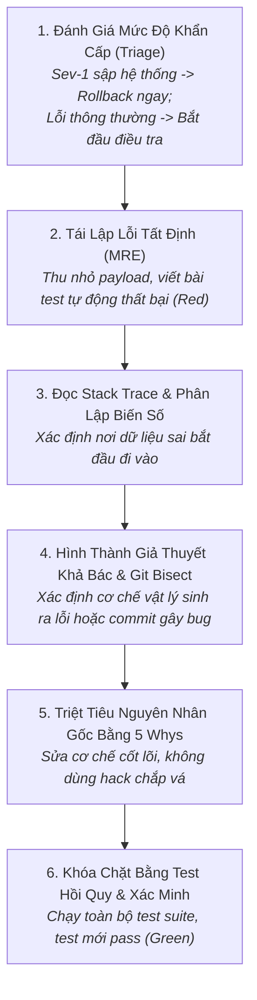

# Quy Trình Chẩn Đoán Lỗi Khoa Học & Điều Tra Gốc Rễ
# Scientific Debugging & Root Cause Investigation Workflow

---

## 1. Mục Đích (Purpose)
Quy trình này hướng dẫn kỹ sư và AI Coding Agent xử lý các lỗi phần mềm và sự cố hệ thống theo **phương pháp luận khoa học nghiêm cẩn (Scientific Method)**: Tái lập lỗi tất định, hình thành và kiểm chứng giả thuyết khả bác, triệt tiêu nguyên nhân gốc rễ (Root Cause) thay vì vá víu triệu chứng bề mặt, và khóa chặt lỗi bằng bài test hồi quy tự động.

---

## 2. Điều Kiện Tiên Quyết (Preconditions)
- Có báo cáo lỗi (Bug Report / Error Alert) kèm thông tin môi trường và dữ liệu đầu vào.
- Có khả năng chạy mã nguồn và test runner trên môi trường phát triển cục bộ.

---

## 3. Dữ Liệu Đầu Vào (Inputs)
- Nhật ký hệ thống (Logs), Stack traces, Request ID, hoặc video/ảnh chụp tái hiện lỗi.
- Bối cảnh thay đổi gần nhất: Danh sách commit gần đây, bản release gần nhất.

---

## 4. Kết Quả Đầu Ra Kỳ Vọng (Expected Outputs)
- **Bài Test Hồi Quy Tự Động (Automated Regression Test):** Thất bại trước khi sửa và vượt qua sau khi sửa.
- **Bản Vá Nguyên Nhân Gốc (Root Cause Fix):** Mã nguồn sửa đổi triệt để cơ chế gây lỗi.
- **Tài liệu Phân tích 5 Whys:** Ghi nhận khiếm khuyết quy trình và biện pháp phòng ngừa dài hạn.

---

## 5. Các Giai Đoạn Chính (Main Stages)

### Chi Tiết Từng Giai Đoạn:
- **GĐ 1: Triage:** Nếu là sự cố sản xuất nghiêm trọng (Data corruption / Service down), ưu tiên hàng đầu là **Rollback về phiên bản an toàn trước đó**, sau đó mới tiến hành điều tra trên môi trường staging/local.
- **GĐ 2: Tái lập tối thiểu (MRE):** Không cố gắng gỡ lỗi trên toàn bộ hệ thống khổng lồ. Rút trích một kịch bản tối thiểu (vài dòng dữ liệu) và bọc vào một bài test (xem [`debugging-and-root-cause.md`](file:///home/longtran/Projects/rendez-web/erpf/software-engineering/implementation-quality/debugging-and-root-cause.md)).
- **GĐ 3: Đọc Stack Trace:** Phân biệt giữa nơi lỗi *phát nổ* (ví dụ: `IndexError` ở thư viện) và nơi *nguyên nhân bắt đầu* (code ứng dụng truyền list rỗng).
- **GĐ 4: Giả thuyết & Git Bisect:** Dùng `git bisect` để tìm chính xác commit gây lỗi nếu bug mới xuất hiện gần đây.
- **GĐ 5: Sửa tận gốc:** Dùng câu hỏi 5 Whys để tìm ra nguyên nhân sâu xa (ví dụ: thiếu ràng buộc DB hoặc thiếu validation ở serializer).
- **GĐ 6: Khóa hồi quy:** Đưa bài test MRE vào test suite chính thức trong CI.

---

## 6. Điểm Ra Quyết Định Rẽ Nhánh (Decision Points & Professional Judgment)

- **Điểm rẽ 1: Lỗi có tái lập được một cách tất định (Deterministic) không?**
  - *Nếu là lỗi chập chờn (Flaky / Heisenbug):* 99% nguyên nhân là do **Race Condition**, bất tất định thời gian mạng, hoặc rò rỉ trạng thái giữa các bài test. Chuyển sang chiến lược kiểm tra tranh chấp (Locking audit & Concurrency stress-test).
- **Điểm rẽ 2: Vá khẩn cấp (Hotfix) hay Sửa tận gốc (Root Cause Fix)?**
  - *Nếu hệ thống đang chịu ảnh hưởng trực tiếp trên Production:* Áp dụng hotfix an toàn tối thiểu để phục hồi dịch vụ, nhưng **bắt buộc tạo Issue P1** để quay lại thực hiện sửa tận gốc trong vòng 24 giờ.

---

## 7. Phương Pháp & Kỹ Thuật Áp Dụng (Methods & Techniques)
- Quy trình Chẩn đoán lỗi khoa học 6 bước (Scientific Debugging Loop).
- Thu hẹp không gian nhị phân bằng `git bisect run`.
- Phương pháp phân tích nguyên nhân gốc 5 Whys.

---

## 8. Các Dạng Thất Bại & Sai Lầm Thường Gặp (Common Failure Modes)
- **Gỡ lỗi bằng mê tín (Shotgun Debugging):** Sửa ngẫu nhiên vài dòng code cho đến khi thấy chạy được rồi commit vội vã.
- **Che giấu triệu chứng bằng Band-Aid:** Thêm `if x is not None:` hoặc bọc khối `try...except pass` để chương trình không sập, biến lỗi thành hiện tượng thối rữa dữ liệu âm thầm.
- **Sửa bug không có bài test bảo vệ:** Sửa xong bằng tay nhưng không viết bài test tự động, khiến bug tái phát lại vào tháng sau.

---

## 9. Cổng Kiểm Soát Chất Lượng (Quality Checkpoints)
- [ ] Có một bài test tự động fail trước khi sửa và pass sau khi sửa.
- [ ] Không có các câu lệnh `print` tạm thời hoặc code hack che giấu triệu chứng.
- [ ] Toàn bộ test suite cũ đều vượt qua 100% (Zero side-effects).
- [ ] Đã trả lời được câu hỏi 5 Whys về lý do tại sao lỗi không bị phát hiện sớm hơn.

---

## 10. Lộ Trình Thay Thế / Thoát Hiểm (Alternative Paths)
- Nếu sau 4 giờ điều tra mà không thể tìm ra nguyên nhân: **Dừng lại, lùi một bước và giải thích vấn đề cho người khác (Rubber Duck Debugging)** hoặc nhờ một đồng nghiệp độc lập vào xem xét với góc nhìn mới.

---

## 11. Nguyên Lý & Năng Lực Liên Quan
- **Nguyên lý cốt lõi:** Root Cause Analysis, Evidence-Based Reasoning, Intellectual Honesty (`ERPF-CORE-PRIN-001`).
- **Năng lực áp dụng:** C2 (Analytical Reasoning), C3 (Critical Evaluation), C1 (Problem Formulation).
