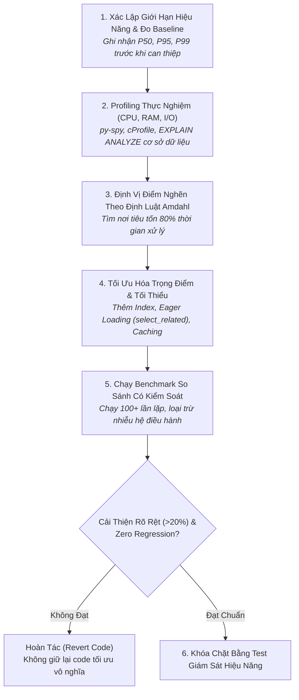

# Quy Trình Điều Tra & Tối Ưu Hóa Hiệu Năng Hệ Thống
# Performance Investigation & Profiling Workflow

---

## 1. Mục Đích (Purpose)
Quy trình này hướng dẫn kỹ sư điều tra và giải quyết các điểm nghẽn hiệu năng dựa trên **đo lường thực nghiệm khách quan (Measurement-First)**: Thu thập số liệu baseline, xác định chính xác điểm nghẽn chi phối (Amdahl's Law), tối ưu hóa có chủ đích và chứng minh sự cải thiện bằng benchmark chuẩn thống kê trước khi thay đổi mã nguồn.

---

## 2. Điều Kiện Tiên Quyết (Preconditions)
- Hệ thống đã chạy đúng logic nghiệp vụ và đã có bộ test tự động kiểm chứng tính đúng đắn.
- Đã xác định rõ mục tiêu hiệu năng cần đạt (SLO: ví dụ P95 Latency $< 50$ms với tải 500 QPS).

---

## 3. Dữ Liệu Đầu Vào (Inputs)
- Báo cáo giám sát độ trễ (APM Traces, Slow Query Logs, hoặc phàn nàn của người dùng).
- Môi trường thử nghiệm có dữ liệu đủ lớn (Database có số lượng bản ghi tương đương production).

---

## 4. Kết Quả Đầu Ra Kỳ Vọng (Expected Outputs)
- **Báo cáo Profiling So Sánh:** Biểu đồ ngọn lửa (Flamegraph) và bảng số liệu phân vị (P50, P95, P99) chứng minh hiệu năng được cải thiện rõ rệt (ít nhất $> 20\%$).
- Mã nguồn tối ưu hóa sạch sẽ, không phá vỡ tính hiển nhiên và kiến trúc hệ thống.

---

## 5. Các Giai Đoạn Chính (Main Stages)

### Chi Tiết Từng Giai Đoạn:
- **GĐ 1: Đo Baseline:** Tuyệt đối không chạm vào code khi chưa ghi lại con số hiện tại (xem [`performance-engineering.md`](file:///home/longtran/Projects/rendez-web/erpf/software-engineering/implementation-quality/performance-engineering.md)).
- **GĐ 2: Profiling thực tế:** Nếu nghi ngờ Database, chạy `EXPLAIN (ANALYZE, BUFFERS)` để xem có bị Sequential Scan không. Nếu nghi ngờ CPU, dùng `py-spy` sinh đồ thị ngọn lửa.
- **GĐ 3: Định luật Amdahl:** Tập trung vào thành phần chiếm nhiều thời gian nhất. Tối ưu một hàm chỉ chiếm 2% thời gian CPU là hoàn toàn vô nghĩa.
- **GĐ 4: Can thiệp tối thiểu:** Áp dụng giải pháp đơn giản nhất: Đánh đúng index $\rightarrow$ Loại bỏ truy vấn N+1 bằng `select_related()` $\rightarrow$ Chỉ đặt Cache khi DB đã tối ưu tối đa.
- **GĐ 5: Benchmark kiểm chứng:** Chạy thử nghiệm trong môi trường cô lập, có chu kỳ làm nóng (warmup).
- **GĐ 6: Quyết định nghiệm thu:** Nếu cải thiện dưới 10% nhưng làm code trở nên khó đọc, **hoàn tác ngay lập tức**!

---

## 6. Điểm Ra Quyết Định Rẽ Nhánh (Decision Points & Professional Judgment)

- **Điểm rẽ 1: Tối ưu hóa Database hay Thêm Cache Redis?**
  - *Nguyên tắc thép:* **Luôn tối ưu hóa câu truy vấn cơ sở dữ liệu trước**. Caching chỉ là giải pháp tạm thời; một câu query chạy 5 giây khi cache hết hạn sẽ đánh sập DB (Cache Stampede).
- **Điểm rẽ 2: Khi nào được phép đánh đổi Clean Code để lấy Hiệu năng?**
  - Chỉ khi đoạn mã đó nằm trên **đường dẫn găng cực hạn (Hot Path)** đã được chứng minh bằng Profiler và hệ thống bắt buộc phải đáp ứng SLA khắt khe. Trong 95% trường hợp, code sạch và code nhanh không hề mâu thuẫn nhau.

---

## 7. Phương Pháp & Kỹ Thuật Áp Dụng (Methods & Techniques)
- Kỹ thuật Profiling không xâm lấn bằng Sampling Profiler (`py-spy`).
- Phân tích kế hoạch thực thi câu lệnh SQL (`EXPLAIN ANALYZE`).
- Triệt tiêu truy vấn N+1 bằng Eager Loading (`select_related` và `prefetch_related`).
- Chiến lược Caching Cache-Aside chống dội tải (Mutex / Dogpile lock).

---

## 8. Các Dạng Thất Bại & Sai Lầm Thường Gặp (Common Failure Modes)
- **Tối ưu hóa sớm bằng trực giác:** Tốn 3 ngày viết lại thuật toán bằng C++ FFI trong khi điểm nghẽn thực sự là thiếu 1 index trên cột `foreign_key`.
- **Dùng giá trị trung bình để tự lừa dối:** Báo cáo "Latency trung bình 20ms" trong khi P99 lên tới 3,000ms khiến 1% người dùng quan trọng nhất rời bỏ ứng dụng.
- **Giữ lại code tối ưu hóa thất bại:** Thử sửa code để tối ưu nhưng tốc độ không tăng, tuy nhiên vẫn tiếc công và merge vào nhánh chính, để lại một đống nợ kỹ thuật khó hiểu cho người sau.

---

## 9. Cổng Kiểm Soát Chất Lượng (Quality Checkpoints)
- [ ] Có số liệu đo lường cụ thể Trước (Baseline) và Sau (Optimized) trên cùng một phần cứng.
- [ ] Độ trễ P95/P99 cải thiện ít nhất 20% hoặc tài nguyên VRAM/CPU giảm rõ rệt.
- [ ] 100% các bài test nghiệp vụ hiện hữu đều vượt qua (Zero logic regression).
- [ ] Không đưa thêm tầng Caching nếu câu truy vấn SQL gốc chưa được đánh index tối ưu.

---

## 10. Lộ Trình Thay Thế / Thoát Hiểm (Alternative Paths)
- Nếu việc tối ưu hóa câu truy vấn đã đạt giới hạn vật lý của đĩa cứng: **Xem xét giải pháp phân tầng dữ liệu (Data Archiving)** — chuyển các bản ghi lịch sử cũ sang bảng lưu trữ lạnh để giảm kích thước bảng hoạt động chính.

---

## 11. Nguyên Lý & Năng Lực Liên Quan
- **Nguyên lý cốt lõi:** Evidence-Based Reasoning, Simplest Sufficient Solution, Systems Thinking (`ERPF-CORE-PRIN-001`).
- **Năng lực áp dụng:** C2 (Analytical Reasoning), C3 (Critical Evaluation), C6 (Systems Thinking).
