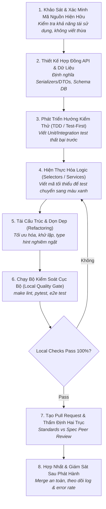

# Chu Trình Phát Triển Phần Mềm Kỷ Luật
# Disciplined Software Development Lifecycle Workflow

---

## 1. Mục Đích (Purpose)
Quy trình này hướng dẫn chu trình phát triển tính năng hoặc mô-đun phần mềm mới từ đầu đến cuối (End-to-End SDLC), đảm bảo mã nguồn sinh ra đạt tiêu chuẩn cao về **tính đúng đắn, dễ bảo trì, có bài test bảo vệ tự động, và không gây hồi quy lỗi hệ thống**.

---

## 2. Điều Kiện Tiên Quyết (Preconditions)
- Yêu cầu chức năng và tiêu chí nghiệm thu đã được định hình rõ ràng theo [`problem-formulation.md`](file:///home/longtran/Projects/rendez-web/erpf/workflows/cross-disciplinary/problem-formulation.md).
- Môi trường phát triển cục bộ và test runner đã sẵn sàng và chạy pass 100% trên nhánh chính (`main`).

---

## 3. Dữ Liệu Đầu Vào (Inputs)
- Bản đặc tả yêu cầu (Issue/Ticket) kèm tiêu chí nghiệm thu (Acceptance Criteria).
- Kho mã nguồn hiện hữu và sơ đồ ranh giới kiến trúc liên quan.

---

## 4. Kết Quả Đầu Ra Kỳ Vọng (Expected Outputs)
- Nhánh mã nguồn hoàn thiện chứa mã thực thi sạch, bộ test tự động toàn diện, tài liệu cập nhật và PR description chất lượng cao.

---

## 5. Các Giai Đoạn Chính (Main Stages)

### Chi Tiết Từng Giai Đoạn:
- **GĐ 1: Khảo sát hiện trạng:** Đọc code hiện có để nắm bắt patterns và conventions (xem [`codebase-exploration.md`](file:///home/longtran/Projects/rendez-web/erpf/workflows/software-engineering/codebase-exploration.md)).
- **GĐ 2: Hợp đồng & Dữ liệu:** Xác định rõ kiểu dữ liệu đầu vào/ra. Cập nhật schema DB qua migrations nếu cần.
- **GĐ 3: Viết test trước:** Viết integration test mô phỏng hành vi nghiệp vụ kỳ vọng. Test phải FAIL ở bước này.
- **GĐ 4: Hiện thực hóa:** Triển khai logic trong `selectors.py` (chỉ đọc) và `services.py` (đột biến an toàn trong transaction).
- **GĐ 5: Tái cấu trúc:** Dọn dẹp code, loại bỏ code thừa, kiểm tra type annotations.
- **GĐ 6: Kiểm soát cục bộ:** Chạy toàn bộ linter (`ruff`, `mypy`, `eslint`, `tsc`) và test suite cục bộ.
- **GĐ 7: Pull Request:** Giới hạn PR dưới 400 dòng thay đổi; mô tả rõ TẠI SAO và bằng chứng test đạt.
- **GĐ 8: Giám sát:** Theo dõi log và metric trên dashboard sau khi merge.

---

## 6. Điểm Ra Quyết Định Rẽ Nhánh (Decision Points & Professional Judgment)

- **Điểm rẽ 1: Tính năng có đòi hỏi thay đổi Schema Cơ sở dữ liệu?**
  - *Nếu có:* Bắt buộc kiểm tra tính tương thích ngược (Backward Compatibility). Tuyệt đối không xóa hoặc đổi tên cột ngay lập tức (áp dụng quy trình Expand and Contract).
- **Điểm rẽ 2: Quyết định bọc Transaction:**
  - Chỉ bọc `transaction.atomic` quanh các thao tác ghi DB bắt buộc đảm bảo ACID. Tuyệt đối không bọc quanh các cuộc gọi mạng bên ngoài hoặc tác vụ xử lý ảnh nặng.

---

## 7. Phương Pháp & Kỹ Thuật Áp Dụng (Methods & Techniques)
- Chu trình Test-Driven Development (Red-Green-Refactor).
- Phân tầng Selectors vs Services ([`implementation-practices.md`](file:///home/longtran/Projects/rendez-web/erpf/software-engineering/implementation-quality/implementation-practices.md)).
- Eager Loading chống N+1 queries ([`performance-engineering.md`](file:///home/longtran/Projects/rendez-web/erpf/software-engineering/implementation-quality/performance-engineering.md)).

---

## 8. Các Dạng Thất Bại & Sai Lầm Thường Gặp (Common Failure Modes)
- **Big-Bang PR:** Gom 10 tính năng khác nhau vào một PR 2,000 dòng khiến không ai review nổi.
- **Bỏ qua Local Checks:** Đẩy code lên GitHub rồi dùng CI runner làm công cụ debug linter.
- **Thiếu test cho trường hợp biên:** Chỉ viết test cho kịch bản thuận lợi (Happy path), bỏ qua lỗi validation và tranh chấp dữ liệu (Race Conditions).

---

## 9. Cổng Kiểm Soát Chất Lượng (Quality Checkpoints)
- [ ] 100% bài test mới và cũ đều vượt qua (Zero regression).
- [ ] Mypy và TypeScript compiler không có bất kỳ cảnh báo kiểu dữ liệu nào.
- [ ] PR dưới 400 dòng mã (ngoại trừ các file tự động sinh như schema hoặc migrations).
- [ ] Đã có ít nhất 1 kỹ sư độc lập approve trên trục Spec.

---

## 10. Lộ Trình Thay Thế / Thoát Hiểm (Alternative Paths)
- Nếu một tính năng phát sinh quá nhiều phức tạp bất ngờ ngoài dự kiến: **Tách nhỏ PR**. Đưa phần nền tảng (Schema migration hoặc DTOs) lên trước; đưa logic nghiệp vụ lên trong các PR tiếp theo.

---

## 11. Nguyên Lý & Năng Lực Liên Quan
- **Nguyên lý cốt lõi:** Evidence-Based Reasoning, Simplest Sufficient Solution, Systems Thinking (`ERPF-CORE-PRIN-001`).
- **Năng lực áp dụng:** C1 (Problem Formulation), C7 (Planning & Prioritization), C9 (Peer Review).
