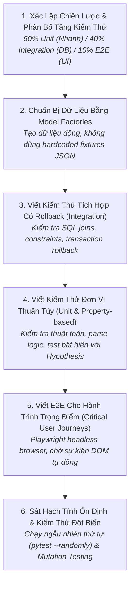

# Quy Trình Kiểm Thử Phần Mềm & Đảm Bảo Chất Lượng
# Software Testing & Quality Assurance Workflow

---

## 1. Mục Đích (Purpose)
Quy trình này hướng dẫn kỹ sư thiết lập và duy trì một **Tấm lưới an toàn kiểm thử tự động đa tầng (Automated Safety Net)** có tốc độ thực thi nhanh, độ tin cậy tuyệt đối, không có kiểm thử chập chờn (Zero Flakiness), phản ánh chính xác các bất biến nghiệp vụ và bảo vệ hệ thống khỏi lỗi hồi quy khi tái cấu trúc.

---

## 2. Điều Kiện Tiên Quyết (Preconditions)
- Đã xác định rõ các ranh giới tin cậy và tiêu chí nghiệm thu của tính năng.
- Môi trường cơ sở dữ liệu kiểm thử (PostgreSQL/PostGIS test DB) đã được cấu hình tự động rollback.

---

## 3. Dữ Liệu Đầu Vào (Inputs)
- Mã nguồn ứng dụng cần kiểm thử.
- Các quy tắc nghiệp vụ bất biến và các ca kiểm thử biên (Edge Cases).

---

## 4. Kết Quả Đầu Ra Kỳ Vọng (Expected Outputs)
- Bộ test suite tự động hoàn chỉnh tuân thủ mẫu AAA (Arrange - Act - Assert).
- Báo cáo kiểm thử đột biến (Mutation Testing Report) chứng minh các bài test thực sự bắt được lỗi.

---

## 5. Các Giai Đoạn Chính (Main Stages)

### Chi Tiết Từng Giai Đoạn:
- **GĐ 1: Phân bổ tầng:** Tránh đảo ngược kim tự tháp (không viết quá nhiều E2E chậm chạp). Dồn trọng tâm vào Unit và Integration (xem [`software-testing.md`](file:///home/longtran/Projects/rendez-web/erpf/software-engineering/implementation-quality/software-testing.md)).
- **GĐ 2: Dữ liệu động:** Sử dụng Factory Boy để tạo đối tượng độc lập cho từng bài test; không dùng ID cố định (`id=1`).
- **GĐ 3: Integration test:** Cho phép truy vấn DB thật trong transaction; kiểm tra các truy vấn không gian phức tạp của PostGIS.
- **GĐ 4: Unit test:** Chạy trên bộ nhớ, dưới 5ms/test; áp dụng Property-Based Testing để tìm các trường hợp biên kỳ lạ.
- **GĐ 5: E2E test:** Chỉ test 3–5 luồng quan trọng nhất (Đăng nhập, Tìm kiếm, Gửi ảnh); cấm dùng `sleep()` cứng.
- **GĐ 6: Diệt trừ Flakiness:** Chạy test suite 10 lần liên tiếp với thứ tự xáo trộn ngẫu nhiên; nếu có 1 lần fail, bài test đó bị coi là lỗi và phải sửa ngay.

---

## 6. Điểm Ra Quyết Định Rẽ Nhánh (Decision Points & Professional Judgment)

- **Điểm rẽ 1: Dùng Database Thật hay Dùng Mock?**
  - *Nguyên tắc bắt buộc:* Mọi kiểm thử liên quan đến Selectors, câu truy vấn SQL, hoặc Schema Invariants **bắt buộc phải chạy trên PostgreSQL thật** (có rollback). Chỉ dùng Mock cho các dịch vụ bên thứ ba (Stripe, AWS S3, Email Gateway).
- **Điểm rẽ 2: Độ bao phủ dòng mã (Line Coverage) có ý nghĩa gì?**
  - 100% line coverage không có nghĩa là hết bug. Sử dụng **Kiểm thử đột biến (Mutation Testing)** để kiểm tra xem khi cố tình sửa sai 1 dòng code, test suite có đỏ không.

---

## 7. Phương Pháp & Kỹ Thuật Áp Dụng (Methods & Techniques)
- Mẫu cấu trúc ca kiểm thử AAA (Arrange - Act - Assert).
- Quản lý dữ liệu kiểm thử bằng Model Factories.
- Kiểm thử dựa trên thuộc tính (Property-Based Testing với Hypothesis).
- Kiểm thử đột biến (Mutation Testing qua `mutmut`).

---

## 8. Các Dạng Thất Bại & Sai Lầm Thường Gặp (Common Failure Modes)
- **Địa ngục Mocking (Mocking Hell):** Mock quá nhiều tầng khiến test pass trên máy nhưng code sập trên production do lỗi cú pháp SQL.
- **Kiểm thử phụ thuộc thứ tự (Order-Dependent Tests):** Test B chỉ pass nếu Test A chạy trước nó.
- **Test không có Assertions:** Chạy code chỉ để tăng % coverage mà không assert kết quả đầu ra.
- **Chờ đợi cứng trong E2E (`page.waitForTimeout(5000)`):** Làm test chạy chậm như rùa và vẫn bị chập chờn khi mạng lag.

---

## 9. Cổng Kiểm Soát Chất Lượng (Quality Checkpoints)
- [ ] Toàn bộ test suite chạy độc lập được với thứ tự ngẫu nhiên (`pytest --randomly`).
- [ ] Không có bất kỳ lệnh chờ cứng (`sleep`) nào trong toàn bộ mã kiểm thử.
- [ ] Mọi integration test đều tự dọn dẹp sạch sẽ cơ sở dữ liệu sau khi chạy xong.
- [ ] Tỷ lệ tiêu diệt đột biến (Mutation Kill Rate) đạt trên 80% đối với core business services.

---

## 10. Lộ Trình Thay Thế / Thoát Hiểm (Alternative Paths)
- Nếu việc dựng cơ sở dữ liệu thật trong môi trường CI quá chậm: **Sử dụng tmpfs (RAM disk) cho thư mục dữ liệu PostgreSQL** trong Docker container của CI để tăng tốc độ I/O lên gấp 10 lần mà vẫn bảo đảm 100% tính chân thực của SQL.

---

## 11. Nguyên Lý & Năng Lực Liên Quan
- **Nguyên lý cốt lõi:** Evidence-Based Reasoning, Intellectual Honesty (`ERPF-CORE-PRIN-001`).
- **Năng lực áp dụng:** C3 (Critical Evaluation), C2 (Analytical Reasoning), C7 (Planning & Prioritization).
